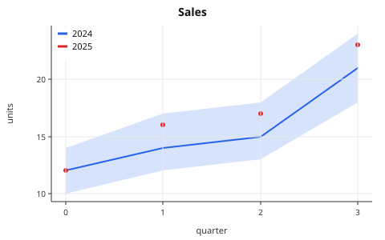

# Libraries

The generated [API index](https://wiz-pl.github.io/wiz/docs/api.html) lists every library
module and declaration, with signatures and doc summaries, and searches names, doc
comments and signatures. The
[reference manual](https://wiz-pl.github.io/wiz/docs/reference.html) is the library as one
document: per module, every public declaration's full signature (implicit arguments
included), its doc comment, the instances of each class (and for each type), and a
notation table with each operator's precedence and associativity and what it expands to.
It is generated from the elaborated modules and not committed: the flake's `reference`
package runs `wiz doc --lib --reference` with the packaged `wiz` (`nix build .#reference`;
`result/index.md` is the Markdown, a Cachix hit while the compiler and `lib/` are
unchanged), and the published site has it as `/docs/reference.html` (every module page
links to it) and `/docs/reference.md`.

## H0c: vectors and bit vectors

`lib/Vec.wiz` (`import Vec`): `Fin n` (a `Nat` with an erased proof `Nat.lt val n = .true`;
`Fin.of 5 3 rfl`) and `Vec A n`, whose length is an **erased** index: at runtime a
vector is a list, and `Vec.length` counts it, with `Vec.length_eq : Vec.length v = n`.
Functions: `head`/`tail`/`last`/`init` on non-empty vectors, `get`/`set` by `Fin`,
`map`, `zipWith`, `zip`, `foldl`/`foldr`, `replicate`, `ofFn`, `append`, `reverse`
(linear, with a `cast` along `m + (k+1) = (m+k)+1`), `snoc`, `splitAt`, `shiftIn`,
`toList`/`fromList` (`fromList l : Vec A (List.length l)`). Theorems: `length_eq`,
`length_toList`, `toList_fromList`, `map_map`, `get_set` (`get (set v i x) i = x`),
`get_map`, and the `Nat` lemmas they need (`add_zero`, `add_succ`, `add_comm`), all by
structural recursion. `map_map`, `get_set` and `get_map` go through equations such as
`Vec.map_cons : map f (cons x xs) = cons (f x) (map f xs)`, which hold only up to casts at
the element type and are proved with the Prelude's axiom `castRefl` (below).

`lib/BitVec.wiz` (`import BitVec`): `BitVec n` (since [22h](stages/22-numbers.md), `UIntN n` under another name), a `Nat` below `2^n` by construction
(every operation reduces mod `2^n`). Wrapping `add`/`sub`/`neg`/`mul`, `udiv`/`umod`,
`and`/`or`/`xor`/`not`, `shl`/`lshr`/`ashr`, `getBit`, `msb`, `beq`/`ult`/`ule`/`slt`/`sle`,
`concat`, `extract hi lo`, `zeroExtend`, `signExtend`, and `toVec`/`ofVec` (to and
from `Vec Bool n`, least significant bit first). Operations that need `2^n` take the
width at runtime (`{ω n : Nat}`). The arithmetic is the Prelude's native `Nat`
operations ([22a](stages/22-numbers.md)), so the kernel computes on literal bit vectors:
`(BitVec.add (BitVec.ofNat 8 200) (BitVec.ofNat 8 100)).toNat = 44 := rfl`. Compiled code
runs `lib/Word.wiz`'s native words ([22h](stages/22-numbers.md)).

Along the way the elaborator learned to:
* keep erased constructor fields and arguments erased when a `match` reverts them, and
  name a field directly instead of through a `let` at ω (`| .mk i h => … h …` with
  `0 h`);
* prove an equation that has already computed with `rfl` (`Nat.succ a = Nat.succ a`
  is a Σ of `True`s and `a = a`), and recompute an equation stuck on a metavariable
  once it is solved (`congrArg Nat.succ ih` against such a goal). The proof follows the
  elaborator's computed form; where the kernel computes the equation to another shape
  (a numeral on one side, a constructor on the other), the kernel rejects it;
* erase a `cast` against its source type (the solution rule casts a function, so
  `head`, `tail` and `zipWith` on vectors failed at runtime).

Not yet: facts like `Vec.get v (Fin.of 3 1 rfl) = 20 := rfl` (the `rfl` shape
problem above; `drafts/vec-lib/VecProofs.wiz`), arithmetic facts about `BitVec` in general, numerals and operators
(`a + b`) for `BitVec` (decision HD9).

`lib/BitVecShift.wiz` (`import BitVecShift`): the first of those arithmetic facts, for
shifts. `BitVec.toNat_concat_zero`, `BitVec.shl_toNat` and `BitVec.shlStage_toNat` put
the barrel's left `concat`/`slice` stages and `BitVec.shl` in one normal form (the low
bits of a product); `Bits.low_shift` and `Bits.low_low` compose stages. The right-shift
side has `BitVec.lshr_toNat`/`lshr_low_toNat` (`Bits.high`, the barrel's other normal
form), the stage `BitVec.shrStage`/`shrStage_toNat`, and the stage-composition facts
`Bits.low_of_lt`, `Bits.low_low_rev`, `Bits.high_high`, `Bits.high_lt`,
`Bits.div_add_pow`/`high_add_pow`, `Bits.high_add_pow_l`, `Bits.high_low`, plus the fill
lemmas `BitVec.and_zero_left`/`and_one_left`/`and_zero_toNat` and the fill-by-value
stage `BitVec.fillWord`/`shrStageK` (a symbolic fill value, so a probe's `Nat` steps are
genuine equations). For arithmetic shifts `Bits.sub_one_high` and `Bits.sub_pow_ones` are
the ones-fill identities, `Bits.pow_add`/`pow_sub`/`dec_mul`/`add_sub_one` are its `Nat`
lemmas, and `IntN.shiftRight_pos_toNat`/`neg_toNat`/`neg_ones_toNat` read
`IntN.shiftRight` (the `BitVec.ashr` of `lib/BitVec.wiz`) in `toNat` form; they use the
now-public `IntN.shiftRightBody`/`IntN.below_toNat` of `lib/Word.wiz`. This is the lemma set the RV core's barrel shifter proofs need (SLLI is closed;
the right-shift instruction probes are blocked on a conversion limitation, see
`wiz-notes/rv-shift-lemmas.md`). It imports `BitBlast` for `Bits.low`, so it is a proof
module, not part of `BitVec` itself.

`lib/BitVecAdd.wiz` (`import BitVecAdd`): the 34-bit carry/borrow adder of a RISC-V ALU
in word form. `BitVec.adcForm` is `zext1 {a, 1} + zext1 {b', sub}` (`b' = b`, or `~b`
when subtracting, `BitVec.muxBit` being `Hw.mux` at values) and `BitVec.adc` is its
`slice 1 32`, so `BitVec.adc s a b` is the core's expression for any control bit `s`.
The bridge puts the pieces in the same `toNat`/`Bits.low` normal form as
`BitVecShift`: `BitVec.catToNat`/`zext1ToNat` for a concatenation, `Bits.low33_cat`/
`low33_cat0` (`Bits.low_of_lt` under `A * 2 + 1 < 2^33`, from `Bits.cat_lt`),
`Bits.div_low_succ` (a `low (w+1)` divided by 2 is the `low w` of the divide, so the
carry bit falls off) and `Bits.div_two_add`/`div_two`. The result is
`BitVec.adc_zero`/`adc_one` (`add`/`sub`) and `BitVec.adc_eq`
(`adc s a b = muxBit s (sub a b) (add a b)`), plus the `toNat` forms `adcW1`,
`adcW2_zero`, `adcW2_one`, `adc_zero_toNat`, `adc_one_toNat`. This closes FINDINGS.md
H2 for `wiz-rv`: ADD, ADDI and SUB are one `Eq.congrArg` each
(`drafts/rv-add/AddSub.wiz`). For the comparisons it also has the carry-out half:
`Bits.div_div` (`(n/2^k)/2^j = n/2^(k+j)`), `Bits.div_low_pow`
(`div (low (w+1) n) 2^w = low 1 (div n 2^w)`), `Bits.div_one_of` (`P ≤ Z < 2P → Z/P = 1`)
and `Bits.borrow_le`/`borrow_gt` (the borrow of `a + (2^32 - b)`, i.e. `a < b`). It
imports `BitVecShift` for the `Bits.low`/`low_low` lemmas, so it is a proof module too;
what remains for SLT/SLTU is the 1-bit assembly around `bitOf 33` (see
`drafts/rv-add/README.md` and `wiz-notes/rv-core-proofs.md`).

## H14 S0: hardware as tagless-final code, with sharing

`lib/Hdl/Core.wiz` (`import Hdl.Core`) is the L2 layer of the HDL plan: combinational
logic is code polymorphic in its representation, `{r : HwTy → Type} → [Hw r] → r a → r b`,
over hardware type codes `HwTy` (`bits n`, `prod a b`). `Hw` has the operations (`lit`,
`add`, `sub`, `mul`, `and`, `or`, `xor`, `not`, `eq`, `ult`, `mux`, `cat`, `slice`, `pair`,
`fst`, `snd`, `share`); such code can only combine wires with them, so it is synthesisable
by construction. Two instances: `HwTy.El` (values: simulation) and `Wire` (a netlist
builder). A `Circuit i o` is a Mealy machine whose step is such code: `Circuit.run`
simulates it on values, `Circuit.netlist` builds its netlist, `Netlist.simulate` runs the
netlist, and `Verilog.emit` prints Verilog-2005. The module declares its registers (with sized initial
values), then one wire per node, then the register updates, so every name is declared
before its use (Icarus Verilog insists; the `hdl` test group runs it when it is installed). `examples/hdl.wiz` has a counter, a
saturating counter, a popcount, a 4-tap sum and a doubling chain.

Sharing has two parts:
* the netlist builder **hash-conses**: emitting a node whose operation, width and
  arguments (sorted, for commutative operations) are already present returns the existing
  node, so identical subterms are one node however they were reached;
* **auto-share**: in check mode, a `let x := v; body` with no explicit quantity becomes
  `ShareLet.share v (fun x => body)` when the class `ShareLet` is declared and an instance
  `ShareLet A B` exists for the value's type `A` and the body's type `B`. `Hdl.Core`'s one
  instance is `[Hw r] → ShareLet (r a) (r b)` (through `Hw.share`), so a meta-level `let`
  of an object value names one wire: the doubling chain `let y := x + x` at depth 20
  emits 20 adders in 25 builder steps. Write `let ω x := …` to opt out.

## H14 S1: a usable HDL: names, bundles, composition, reset, emitters

Driven by a real design (a UART on a Lattice iCEstick, written in this library and run on
the board; its findings G1–G10 are the requirements). Design notes:
`wiz-notes/hdl-usability.md`. Everything is in `lib/Hdl/Core.wiz`; examples and
tests in `examples/hdl-compose.wiz` (group `hdl`) and in the `scaling` group.

```wiz no-check
structure Tx (r : HwTy → Type) where      -- a bundle: a structure of signals
  line : r Bit
  left : r B4
  deriving Bundle                         -- Tx.code, Tx.pack, Tx.unpack, Tx.bundle
def txStep {r : HwTy → Type} [Hw r] (s : Tx r) (go : r Bit) : r Tx.code :=
  let idle := Hw.eq s.left (Hw.lit 4 0);  -- field access by name
  Tx.pack (Tx.mk (Hw.mux go (Hw.lit 1 0) s.line) (Hw.label "left" …))
def top : Circuit In.code Out.code := Circuit.bundled Tx.bundle In.bundle Out.bundle init topStep
-- module top(input clk, input [0:0] rx, output [0:0] tx, output [4:0] leds); reg … line; reg … left;
```

* **Structured wires.** `Wire t` is a product of node ids, one per leaf of `t`: pairs and
  projections emit nothing, `mux` at a product is one multiplexer per leaf. A code may
  carry names, `HwTy.named s t` (ignored by `El`, `width` and the bus encoding). Ports
  and registers are one per leaf, named by the path of `named` segments joined with `_`
  (`HwTy.portNames`; an unnamed leaf is `x`/`y`/`r`, with `_k` where names would clash);
  wires are named by `Hw.label "name" x`, others are `nK`. Verilog names are sanitised
  and unique. `Hw` gained `const`, `tag`/`untag`, `label`, `resetTo`, `hold`.
* **Bundles.** A structure parameterised by `r : HwTy → Type` with fields `r T` or nested
  bundles; `deriving Bundle` defines its code (a product of `named` fields) and the
  conversions. The code's tails are definitions too (`S.code := HwTy.prod (named "f₀" T₀)
  S.code.tail1`, …), `pack` ascribes each rest its tail's name and `unpack` walks the
  product with one `let` per field, so the code of both is linear in the number of fields
  (it was quadratic and cubic). (Reading field k of a structure is still k projections in
  the IR, so `pack` of a wide bundle has a quadratic number of projections.) A bundle is a *value* (`S.bundle`), not an instance: structures are
  structural types, so two structures with the same field types are one type and
  instance resolution could not tell their bundles apart (instances once declared types get
  kernel-level brands).
* **Composition** (Lava/Clash-style arrows): `Circuit.comb`, `delay`, `seq`, `par`,
  `loop` (feedback through a register), `named` (names the state), `mapIn`/`mapOut`,
  `inputName`/`outputName`, and `Circuit.inst c s x` for an instance with its own state
  inside a hand-written step. Each has its semantics as a lemma: `Circuit.runFrom_seq`,
  `run_seq` (`run (seq a b) xs = run b (run a xs)`), `run_par`, `run_delay`,
  `runFrom_loop`, `run_named`, `runFrom_comb`, `inst_el`, `stepEl_withReset`/`Enable`.
  Combinational code passed to a combinator is a function at every representation,
  `Comb i o := {r : HwTy → Type} → [Hw r] → r i → r o` (`Circuit.comb (fun x => Hw.xor x k)`),
  and a bundled step is such a function on structures (`Circuit.bundled … cntStep`).
  The netlist is flat.
* **Reset and enable**, by construction: `Circuit.withReset c` adds an input `rst` (while
  high, the next state is `c.init`: synchronous) and `withEnable` an input `en` (while low,
  the state holds), built from `Hw.resetTo`/`Hw.hold`, whose meaning at values is a
  multiplexer and which the netlist turns into a reset or enable of the register they
  feed: `always @(posedge clk) if (rst) r <= 4'd0; else if (en) r <= next;`. Where the
  pattern does not apply (a `resetTo` not feeding a register), the node stays a
  multiplexer with the same meaning. `initial` values are always printed.
* **Emitters.** `Testbench.verilog n vec cycles` (a bench that replays a vector file and
  compares every output in every cycle), `Circuit.vectors n c xs` (the vector file of a
  value simulation), `Vcd.ofRun name c xs` (a waveform of every input, output and state
  leaf), `Pcf.emit n clkPin pins` and `Pcf.check` (pin constraints from named ports:
  `Pin.one "uart_tx" 8`, `Pin.bus "leds" [99, 98, …]`).
* **Designs in a list.** `Circuit i o` quantifies over representations and lives in
  `Type 1`; `Circuit.design name c : Design` packs a top at the first order (the step at
  values and the netlist), so `List Design` works.
* **Simulation scales.** `Circuit.run` is tail recursive (`Circuit.run_eq` relates it to
  the structural `Circuit.runFrom`, the one to reason with); `Netlist.simulate` keeps node
  values in a skew-binary random-access list: O(n log n) per cycle instead of O(n²).
* **Names.** The generic helpers are `Hdl.map`, `Hdl.nthD`, `Hdl.rev`, `Hdl.show`, …
  (importers keep `List.map` and the like); the netlist types are `NetOp`, `NetNode`,
  `NetReg`, `NetPort`. (`<+>` stays.)

Not done: module hierarchy in the Verilog, enumerations at `HwTy`, wire names from `let`
binders (an elaborator hook, wishful `hdl-let-names`), asynchronous reset, several clocks.
(Numerals and operators: H14 S2.)

## H14 S2: operator notation for signals

Signals are written with operators: `c + 1`, `x &&& ~~~y`, `s.left === 0`,
`if go then 10 else if tick then s.left - 1 else s.left`, instead of
`Hw.add c (Hw.lit 7 1)` …, `Hw.mux go (Hw.lit 4 10) (Hw.mux tick …)`.
`examples/hdl-operators.wiz` shows each design both ways.

| notation (at `r (HwTy.bits n)`, `[Hw r]`) | meaning | precedence |
|---|---|---|
| numeral `k` | `Hw.lit n k`: the width from the type | |
| `a + b`, `a - b`, `a * b`, `-a` | `Hw.add`, `Hw.sub`, `Hw.mul`, `0 - a` | 65, 65, 70, 75 |
| `a &&& b`, `a ^^^ b`, `a \|\|\| b`, `~~~a` | `Hw.and`, `Hw.xor`, `Hw.or`, `Hw.not` | 60, 58, 55, max |
| `a <<< k`, `a >>> k` (`k : Nat`) | logical shifts by a fixed number of places: wiring (`Hw.shl`, `Hw.lshr`) | 75 |
| `a <ᵤ b`, `a ≤ᵤ b`, `a >ᵤ b`, `a ≥ᵤ b` | unsigned comparisons, one bit (`Hw.ult`, `Hw.ule`, `Hw.ugt`, `Hw.uge`) | 62 |
| `a === b`, `a =/= b` | equality, inequality, one bit (`Hw.eq`, `Hw.neq`) | 61 |
| `if c then a else b` (`c : r HwTy.bit`) | `Hw.mux c a b`, at any `r t` | |

* **Classes.** `+ - * -x` and numerals are the numeric classes (`Add` … `OfNat`, HD9).
  The bitwise operators are new classes in the prelude, as in Lean: `AndOp`, `OrOp`,
  `XorOp`, `Complement`, `ShiftLeft`, `ShiftRight`, with instances for `Nat`, `UIntN w`
  (and so `BitVec n`) and signals. The shifts take the amount as a `Nat`: a fixed amount
  is what hardware shifts by wiring (a concatenation with `k` zeros and a slice; no
  shifter; by `n` or more places, `0`).
* **Comparisons are the HDL's own.** They return a 1-bit signal, not a `Bool`, so they are
  not `==`/`<` (Chisel makes the same choice: `===`, `=/=`), and they are unsigned (`ᵤ`,
  leaving room for signed ones). As in Verilog they bind tighter than the bitwise
  operators: `idle &&& s.cnt === 9` needs no parentheses.
* **`if` on a signal.** `if c then a else b` is a `match` on a `Bool` (13c). When the
  condition's type is not a data type and has an instance `Mux C C` (the prelude's class
  `Mux C A`, whose HDL instance is `Mux (r HwTy.bit) (r t)`), the elaborator makes it
  `Mux.mux c a b` instead (`ifMux?` in `Wiz/Elab/Term.lean`), at an instance `Mux C A`
  for the branches' type `A`. Every other condition (a `Bool`, an unsolved type, `Nat`, a
  type without a `Mux` instance) takes the ordinary path, with its messages, and
  `if b then rfl else rfl` still refines the goal. A branch that is a numeral (or an `if`
  of numerals) is elaborated after the other, so `if t then 0 else c + 1` gets its width
  from `c`.
* **Constants of the expected width.** A numeral is a literal; a meta-level `Nat`
  expression is `Hw.ofNat e` (`c === Hw.ofNat (n - 1)`), whose width comes from the type.
* **Same circuits.** The instances are the `Hw` operations, so a circuit written with the
  operators has the netlist and the Verilog of the one written with `Hw.add` …, byte for
  byte (`examples/hdl-operators.wiz`; also the iCEstick UART's `txStep` and `rxStep`
  rewritten). Associativity matters for that: `a &&& b &&& c` is `(a &&& b) &&& c`, a
  different (equivalent) netlist from `Hw.and a (Hw.and b c)`.
* **Printing.** The operators print back as written (11r): `fun x y => if x === y then
  x + 1 else x <<< 2 &&& ~~~y`. `Mux.mux` and `Hw.mux` print as `if`; and a numeral at any
  type other than `Nat` (`OfNat.ofNat A n _`) now prints as the numeral, for `Int` and
  words too (`fun x => x + 1 : Int → Int`).

Not done: ASCII spellings of `≤ᵤ` …. (Shifts by a signal, signed comparisons, arithmetic
shift and `&&`/`||` on signals: H14 S4.)

## H14 T: temporal properties of circuits (prototype)

Stating and proving properties of circuits over unbounded time, after TLA+, LTL and
SVA. `lib/Hdl/Temporal.wiz`, on the traces and Mealy machines of H14 C1 (`lib/Trace.wiz`);
examples and tests in `examples/hdl-temporal.wiz` (group `hdl`). Survey and design:
`wiz-notes/hdl-temporal.md`.

```wiz no-check
def Uart.onlyThat_a5 :     -- the loopback reports byte 0xa5 and nothing else, for ever
    TL.always (TL.nowB (fun o => onlyByte 165 o.1 o.2)) (Mealy.obs loopM loopback.init (sendOnce 165)) 0 :=
  Mealy.always_settled_const loopM (onlyByte 165) loopback.init (sendOnce 165) quiet F (loopIdle 165)
    (sendOnce_from 165) (refl Bool.true) (refl (loopIdle 165)) (loopIdle_fixed 165) (loopIdle_ok 165)
```

* **Formulas** `TL A := Trace A → Nat → Prop`: a proposition about a trace at a cycle.
  `TL.always φ σ t := ∀ k, φ σ (k + t)`, `TL.eventually` its `∃` (traces are functions, so
  □ is a Π and ◇ an impredicative `∃`, not ν and μ).
* **Operators**: `now`/`nowB` (atoms), `and`/`or`/`imp`/`not`, `next` (○), `nexts n`
  (`##n`), `within n` and `during n` (bounded ◇ and □), `delayRange m n` (`##[m:n]`),
  `until`, `implies`/`impliesNext` (`|->`/`|=>` for a Boolean antecedent), `past n`
  (`$past`), and TLA's `leadsTo`, `infOften`, `WF`, `SF`, `act` and `stut` (`[R]_v`).
* **Laws**: `always_now`, `always_next`, `always_cons`, `always_ind` (induction on time),
  `always_of`, `always_mono`, `always_and`, `always_during`, `eventually_now`,
  `eventually_next`, `eventually_mono`, `within_eventually`, `splitTime`/`splitAt` (a
  transient phase, then the rest).
* **Proof rules** (with `Mealy.invariant` and `Mealy.simulates` from H14 C1):
  `Mealy.refinesStut` (TLA refinement up to stuttering), `TL.fairStep` (liveness from a
  fair Boolean event: WF1), `TL.rank` (liveness with a bound from a ranking function),
  `Mealy.settles`, `always_settled` and `always_settled_const` (the run reaches a state
  that is fixed under the remaining inputs; the facts are named, `Mealy.Reaches`,
  `Mealy.Fixed`, `Trace.From`, so that concrete instances are matched by name).
* **Bounded checks by evaluation**: `Mealy.checkFrom`/`findFrom` (one pass over a run)
  with `_spec`, `checkFrom_during`, `findFrom_within`: `refl Bool.true` (the kernel
  evaluates) becomes a temporal statement. For long checks, `native_refl` (stage 27a).

* **Refinement and case-analysis tools** (lib/Trace.wiz, from H14 T2):
  `Mealy.simulatesInv`/`simulatesInvOut` (refinement for the specification's reachable
  states: the one-step premise only from states satisfying an invariant it preserves),
  `Mealy.follows` (a run along a known path `F`: from `F 0` at `t`, every step `k < K`
  taken on the inputs that come, gives `stateAt (k + t) = F k`), `Mealy.seq` with
  `seq_stateAt`/`seq_outAt` (two machines in sequence, `Circuit.seq` on traces: the second
  runs on the first's outputs), `Nat.All P n`/`Nat.all_spec` (a table of the cases
  `P 0 … P (n-1)` gives `∀ k < n, P k`), `Bool.all`/`Bool.forall9` (a Boolean check of all
  2^9 inputs, `refl Bool.true`, holds at every input), `Bool.indP` (Bool elimination into
  `Prop`), and small Nat facts (`Nat.lt_succ_split`, `Nat.lt_to_succ`, `Nat.lt_self_succ`,
  `Nat.eq_of_beq`). Word equality from numbers is `UIntN.ext` (lib/Word.wiz): since
  words carry their range (stage 22k), a word is not definitionally `BitVec.mk` of its
  number, so the H14 T2 proofs call `UIntN.ext` directly.

The examples: the UART transmitter's line is high whenever it is idle, at every cycle;
the loopback delivers the byte sent within 45 cycles and reports no other, for ever
(per byte: 48 evaluated cycles and a fixed point); a valid/ready buffer refines a
Bool-level specification for every input trace (eight cases of the control bits, data
variables), keeps an offered item stable (AXI), and hands on every accepted item if the
consumer is ready infinitely often.

The iCEstick UART (`examples/hdl-uart-temporal.wiz`, group `hdl-uart-temporal` in a
heavy shard, about three minutes) is the same method on a real design: the transmitter
is idle-high and frames every accepted byte for 40 cycles, the receiver reports a
well-formed frame (and nothing on a bad stop bit or a short glitch), and the loopback
delivers each byte 41 cycles after it is accepted, for every input trace and byte.

Not done: sequences with repetition (SEREs; planned as monitor circuits), stuttering
invariance as a theorem, a deep embedding printable as SVA, notation (□, ◇, `|->`:
dsl-ergo, stacked on this), case splits on neutral bits (they need the range of `UIntN` in
the sealed type; wishful `uintn-range-proof`), a tactic for the Bool case splits.

## H14 T2: the iCEstick UART, temporal properties

The first use of H14 T on a real design: the UART of wiz-icestick-uart
(`src/Icestick/Uart.wiz`: transmitter, two-flip-flop synchroniser, receiver), copied
unchanged into `examples/hdl-uart-temporal.wiz` (group `hdl-uart-temporal`, a heavy
shard: about three minutes cold), with 4 clock cycles per bit. Everything is
kernel-checked, for **every input trace** and **every byte** (a byte is 8 Booleans,
`Bits8`; `byte d : BitVec 8` is the word), with no `sat_decide`, no `native_refl` and no
bit lemmas beyond four lemmas about the shift registers. The generated table proofs are
at statement level (they build each equation through a propositional motive rather than
unfolding the `transp`/cast spines), so the file checks in ~171 s cold instead of >700 s
(`scripts/gen-uart-temporal.py` regenerates it).

| claim | statement |
|---|---|
| `Tx.idleHigh` | □ (idle → line high): `TL.always (TL.imp Tx.idleA …) (Tx.obs xs) 0` |
| `Tx.frame`, `Tx.frameTL` | a byte `e` taken at cycle t (idle and start): for m < 40 the circuit's line at t+1+m is bit m/4 of the frame (start, `e`'s bits least significant first, stop), 4 cycles each; start is ignored meanwhile |
| `Tx.returns`, `Tx.accepts` | at t+41 the transmitter is idle again, and a start then begins the next frame |
| `Rx.receives`, `Rx.quiet`, `Rx.idleAfter` | idle at v (any counter, any register) and fed a well-formed frame of `e` (`Rx.WellFormed`: the transmitter's waveform up to the stop bit's middle): no report before v+38, `valid` with `byte e` at v+38, idle at v+39 |
| `Rx.badStop` | the same with a low stop bit: no report, idle at v+39 (the design returns to idle; the low line then starts the next frame) |
| `Rx.glitch` | a low pulse gone at the start bit's sample (v+2) is ignored: idle at v+3, register unchanged |
| `Loop.delivers`, `Loop.silent` (+ `Loop.refinesOut`) | transmitter → synchroniser → receiver (`loopC`, the board's loopback): a byte taken at t while the loopback is quiet (`Loop.Quiet`) is reported at t+41, nothing in between |
| `Loop.firstByte` | after reset, for every input trace whose first start is at t, the byte is reported at t+41 |

**Method.** (1) Specifications on friendly types: `Tx.spec`, `Rx.spec`, `Sy.spec`, with
control as Nats, data as Booleans, the state a one-constructor `inductive`. (2) The
refinement premise, one step for every reachable control state (`Tx.inv`, `Rx.inv`):
the circuit's step is first rewritten, by one `refl` with everything a variable, into
its *decision form* `Tx.G`/`Rx.G` (the same gates on plain tuples, with the comparisons
`left == 0`, `cnt == 3`, … as Booleans); the cases (44 for the transmitter, 38 + one
lemma for all 128 idle counter values of the receiver) are evaluations of the decision
form with the data as variables, plus four word lemmas (`Uart.shift_reg9`,
`Uart.bit0_reg9`, `Uart.frame_byte`, `Uart.shift8_byte`, each 2^9 Boolean evaluations
via `Bool.forall9`). The cases are generated by `scripts/gen-uart-temporal.py`. (3)
`Mealy.simulatesInv` gives the circuit's run as the image of the specification's, for
ever; `Mealy.seq_outAt` and the synchroniser's refinement give the loopback's. (4) The
properties are proved on the specifications: `Mealy.follows` (a run along a known path:
the 40 cycles of a frame, the 39 of a reception) and `Nat.all_spec` (case tables over
small Nats).

**Generalisation.** The proofs are for 4 cycles per bit; the board uses 104. Nothing
in them depends on the number except the case tables: with n cycles per bit the
transmitter has 11·n control states, the receiver 2 + 9·n (+ the idle lemma), a frame
10·n cycles and a reception 10·n − 2. The generator takes `N`; the specifications'
constants (3, 1 for the counter, 40/38/39 for the frames) become `n - 1`, `n/2 - 1`, …
For n = 104 that is ~1100 transmitter and ~950 receiver cases: the same proof, too slow
for the kernel today (see the findings), or a parametric proof by induction on the
counter (the counter lemmas `Rx.incs` are already per value).

**Findings (what H14 T and the kernel lacked).** Repros in
`wiz-notes/perf-repros/` (relative to the repository root).
* *Eq at a record type with stuck sides* is η-split by conversion and each field
  re-walks the stuck computation: `stateAt m s0 xs (succ t) = (m (stateAt …) (xs t)).1` by
  `rfl` takes 107 s with the state `Nat × (Nat × Bits8)` and 1.8 s with a one-constructor
  inductive (`record-eq-eta/`; analysed by glued-eq: wishful `conv-sigma-eta-neutral`).
  Workaround: inductive specification states.
* *Case tables over expensive propositions*: `Nat.All P 128` whose entries are step
  equations (a few muxes) costs ~1.3 s per entry to check against the table (180 s
  for 128), while a table of closed facts costs ms. Workaround: the decision form with
  Boolean logic (`Rx.G2`, equal to `Rx.G` for all 32 comparison values), so the idle step
  is one lemma for every counter.
* *Circuit steps in types are expensive*: a proposition mentioning `txM (Tx.st …)`
  (bundle packing, the whole step) costs ~0.5 s per mention; hence the decision form,
  related to the circuit by a single `refl`.
* *Equations between circuit outputs*: composing `Rx.refinesOut` (circuit output = image
  of the specification's) with `Rx.receives` into one equation about the circuit's
  `Byte` output fails: with implicit arguments the elaborator computes the first
  equation's type into its Σ form ("expected ?a = ?b"), and with the middle terms given
  (`@Eq.trans`, or through `Eq.congrArg (fun o => o)`) the check goes over 2 GB (the
  record-η issue again, with the circuit's step as the stuck side). The circuit-level
  statements are therefore the refinement theorems (`Tx.refinesOut`, `Rx.refinesOut`,
  `Loop.refinesOut`) plus the specification-level properties; the transmitter's line
  (one field) composes fine (`Tx.frame`).
* Missing in the library, now in lib/Trace.wiz (see H14 T): `Mealy.simulatesInv`,
  `Mealy.follows`, `Mealy.seq`, `Nat.All`, `Bool.forall9`, `Bool.indP`. (Word equality
  from numbers is `UIntN.ext`, lib/Word.wiz; the old `BitVec.eqOfNat` helper is gone:
  its `rfl` premises do not hold once a word carries its range.)
* The temporal vocabulary had no *rigid (local) variables* (SVA's `(go, v = data) |=> …`):
  `Tx.frameTL` quantifies the byte outside the formula. `TL.during` reads its formula at
  absolute times, so "bit m/4 at offset m" is written as an explicit `∀ m < 40`.
* No `Nat` literal patterns (`| 0 =>`) in this branch's surface language (13q is
  separate), so frame bits and paths are written with `Nat.beq`/`Nat.lt` matches.
* Not proved: the unconditional loopback for arbitrary sequences of bytes (the joint
  invariant over transmitter, synchroniser and receiver phases; `Loop.Quiet` holds at
  every go of a well-spaced sequence, but only the first byte after reset is discharged,
  `Loop.firstByte`); "nothing is reported that was not sent" (needs reasoning backwards
  from a report).

## H14 C1: traces, the common semantics (`lib/Trace.wiz`)

One semantics for everything that runs step by step (design:
`wiz-notes/cohesion-hardware.md`, 2.1). A trace is a function, `Trace A :=
Nat → A` (equality is pointwise and computes; a ν-stream's is stuck), and a Mealy machine
is a step `Mealy S I O := S → I → S × O`, run along an input trace by
`Mealy.stateAt m s0 xs t` and `Mealy.outAt`. `Mealy.run` is the finite run on a list and
`Mealy.run_take` says it is a prefix of the infinite one. Proof rules on the trace:
`Mealy.invariant` (an inductive invariant under an environment assumption) and
`Mealy.simulates`/`simulatesOut` (refinement by a representation map, one step as the
premise). `Trace.tail`, `map`, `zip`, `cons`, `const`, `once`, `ofList`, `take`.

A circuit is such a machine: `Circuit.mealy c` (its step at values),
`Circuit.trace c xs : Trace (El o)`, `Circuit.stateAt`, `Circuit.obs` (state and input
per cycle, what temporal formulas are about), and `Circuit.run_take`:
`Circuit.run c (Trace.take n xs) = Trace.take n (Circuit.trace c xs)`, so what a
simulation prints is what a theorem about the trace says. The temporal logic (H14 T)
builds on these.

## H14 C3: memories (`HwTy.mem`)

The toy CPU's finding C1 (no memories: a ROM as a chain of multiplexers, RAM as
flip-flops). A memory is a code, `HwTy.mem aw dw` (2^aw words of dw bits), and at values
a function `BitVec aw → BitVec dw`, so reasoning about it is pointwise. `Hw.memRead m a`
reads a word (combinationally); `Hw.memWrite m we a d` is the memory with word `a`
replaced by `d` when `we` is high (a disabled write is the memory itself, so a value
simulation's read costs the number of enabled writes so far, not the number of cycles).
A memory that is part of a circuit's state takes the
writes of its next value at the clock edge; a read of the written value in the same
cycle sees the write (the netlist adds the bypass). `Hw.const (HwTy.mem aw dw) f` is a
ROM. Lemmas: `HwTy.El.memRead_write_miss` (another address: the old word),
`memRead_write_hit`, `memRead_write_off`. A reset leaves the contents alone
(`HwTy.El.resetToAt`, as block RAM does; `Circuit.stepEl_withReset` states it), a clock
enable gates the writes.

In the netlist a memory is a `NetMem` (name, widths, initial contents, its writes in
order) read by `memRead k` nodes; the simulator keeps its contents in a trie. Verilog: an
array with an `initial` block, reads `m[addr]`, the writes in one `always` block (a later
write wins). yosys maps a memory whose read data (or address) goes through a register to
iCE40 block RAM (`SB_RAM40_4K`): `examples/hdl-mem.wiz` (a 16×8 RAM with a registered read,
a ROM; checked by Icarus and yosys in group `hdl` when they are on PATH). Small ROMs
become LUTs, a 256-word one block RAM. For Xilinx 7-series (`synth_xilinx`) the same RAMs
become RAMB18E1 or RAMB36E1 and `Hw.mul` a DSP48E1; a ROM of 4 Kbit or more is declared
`(* rom_style = "block" *)`, without which synth_xilinx builds it of LUTs
(`examples/hdl-arty.wiz`, below). What the netlist cannot express is listed in
`Netlist.errors` and printed as `// error:` lines: a choice between two different
memories, a memory in a port, a state memory replaced instead of written.
## H14 C5: a reusable memory interface (`lib/Hdl/Mem.wiz`)

`lib/Hdl/Mem.wiz` (`import Hdl.Mem`) collects the memory facts a proof or a RAM model
keeps needing. It is a thin layer over `HwTy.mem` (`H14 C3`), not a second memory model:
a word memory is still `BitVec aw → BitVec dw`, and the operations are `Hw.memRead` and
`Hw.memWrite`.

* **Word memory.** `Mem.read`/`Mem.write` write the core operations down; `Mem.index`
  and `Mem.lane` split a byte address into word index and lane, and `Mem.wordByte` is
  byte `i` of a word. The laws are kernel-checked: `read_write_same` (an enabled write is read back at its address),
  `read_write_other` (a read at another address is the old word: no aliasing),
  `read_write_off` (a disabled write changes nothing), `write_write_same` and
  `write_write_other` (the write-write forms).
* **Byte memory.** A byte-addressable memory is `HwTy.mem aw 8`; `Mem.byteRead`,
  `Mem.byteWrite`, `byte_read_write_same`, `_other` and `_off` are its interface. The
  byte-enable law at one byte is `byteEnabled` (enable high: the addressed byte is the
  byte written) and `byteDisabled` (enable low: the byte is unchanged).
* **Byte enables in a word.** `Mem.byteMask dw nb strb` is the `dw`-bit mask of `nb`
  strobe bits (byte `k` is `0xff` when bit `k` is set), `Mem.merge old new mask` is the
  read-modify-write value, and `Mem.writeBytes` is the masked write. The two closed
  32-bit cases (`byteMask_full32`, `byteMask_zero32`) are proved by evaluation; the
  symbolic mask is checked for every strobe pattern and every byte lane of 8-, 16- and
  32-bit words in the example (a checked law is *tested*, not proved).
* **One-cycle and two-cycle RAMs.** `Mem.Req`/`Mem.ReqW`/`Mem.Resp` are the bundles and
  `Mem.Ram` the state (`cells` plus a two-bit wait counter). `Mem.ramC1` answers in the
  request cycle (a write lands at the clock edge, so a read sees the old word);
  `Mem.ramC2` answers two cycles after the request, with the timing of `Bus.ramC`.
  `Mem.ramWC1`/`Mem.ramWC2` take byte strobes and do the read-modify-write of
  `Bus.ramWC`; `Mem.ram1_write_read` is the one-cycle RAM's read-after-write law.

Example: `examples/hdl-mem-laws.wiz` (test group `hdl`) exhaustively checks the mask and
the byte-enable value against an independent byte-memory model, replays every strobe
through both RAMs, and checks value simulation = netlist simulation over a deterministic
stream for the plain and byte-enabled variants.

## H14 C2: lenses for structures and bundles (`lib/OpticDerive.wiz`, `lib/Hdl/Optic.wiz`)

`deriving Lens` gives every field of a structure a lens (lib/Optic.wiz's `Lens S A`), its
laws and the independence of every two distinct fields, all by `rfl`:
`S.fL : Lens (S Δ) T`, `S.fL_lawful : Lens.Lawful S.fL`, `S.f_g_indep : Lens.Indep S.fL
S.gL` (f declared before g; `Hdl.indep_symm` turns it round). The names and statements
are the ones Feral's lowering of `struct` writes, so lowered code can switch to the
deriver. On an HDL bundle (`deriving Bundle, Lens`) a lens is polymorphic in the
representation, `Tx.leftL : Lens (Tx r) (r B4)`: the same lens updates values in a proof
and wires in synthesis. `Hdl.zoom l g` runs a sub-step `g` on the place `l` of a state
(`Hdl.zoom_get`), and `Hdl.zoom_frame` is the frame rule: a place independent of `l` is
unchanged, for every state (no evaluation needed). `Bundle.lens b` (with
`Bundle.Lawful b`, `rfl` for derived bundles) and `HwTy.fstL`/`sndL` are the packed
views at values. Example: `examples/hdl-optic.wiz` (group `hdl`).

## H14 S3: fast simulation for compiled programs (`import Hdl.Sim`)

Compiled, the value simulation (`Circuit.run`, `Design.runLeaves`) runs the step function
at `HwTy.El` every cycle, and with it every meta-level computation the step contains:
table trees and top-level constants (compiled code does not cache a closed top-level
definition: each use computes it again), widths and constants computed from the
configuration, bundle codes, `pack`/`unpack`, and a dictionary call and a closure per
operation. Profiled on the iCEstick OLED demo (`oled_fast`, 1068 netlist nodes, about
1400 cycles/s): about 60% of the time is allocation and reference counting, and the
table trees (`RomT.go`, `List.take`) are rebuilt in every cycle. `Netlist.simulate` is no
faster (an allocation per node in its random-access list).

`lib/Hdl/Sim.wiz` runs the netlist instead: synthesis is the partial evaluation (all the
meta-level work is done once, and the netlist is hash-consed), and the netlist is turned
once into a flat program (a constructor per node with exactly its operands, constants
written once, input ports and register outputs as slots) that runs over native arrays
updated in place (`Array`, lib/Std.wiz). Memories (`NetMem`, H14 C3) are one flat native array (each
memory's words from its base) plus a trie for addresses beyond a memory's range (as raw
port values can give); `memRead` nodes read it during the cycle and the writes are applied
at the clock edge in order (a later write wins), exactly as `Netlist.simulate` does (a read
in the same cycle sees the old contents; the netlist's bypass nodes give the new word).

* `Netlist.simFast n xs` computes exactly what `Netlist.simulate n xs` computes (the same
  formulas on the same numbers, node by node) for every well-formed netlist
  (`Netlist.wellFormed`: arguments refer to earlier nodes, register reads to registers,
  register inputs and outputs to nodes; every netlist `Circuit.netlist` builds), and is
  `Netlist.simulate` on any other.
* `Circuit.simFast c xs` = `Circuit.runLeaves c xs`, `Design.simFast d xs` =
  `Design.runLeaves d xs`, by the netlist's agreement with the values (which the `hdl`
  group and a design's own check, such as `oled gen`'s, establish).
* Compiled code only: `Array` has no definition the kernel or `#eval` could run.
* About 25× the value simulation on `oled_fast` (about 35000 cycles/s) and 13× on
  `examples/hdl-sim-bench.wiz` (informal numbers; `bench/hdl-sim` in wiz-tools times it).
  `examples/hdl-sim.wiz` (the `hdl` group) checks `simFast` against `Netlist.simulate`
  (hash-consed and naive netlists) and `Circuit.run` on every operation, 70-bit widths,
  reset and enable, a table tree and composition, and the fallback.

Not done: skipping nodes whose arguments did not change (event-driven simulation),
generated C for a netlist, a value simulation that keeps its meta-level work (caching
closed top-level definitions in compiled code would remove the table rebuilding).

### When `Netlist.simulate` is `Circuit.run` (`lib/Hdl/Netlist.wiz`)

`lib/Hdl/Netlist.wiz` (`import Hdl.Netlist`) proves the scoped simulation theorem
(HW-05's `Netlist.simulate = Circuit.run`). The two simulations are different programs —
one runs the Mealy step at `HwTy.El` values, the other the synthesised nodes — so their
agreement is a theorem. `Circuit.Simulates c n` is the smallest relation that says so,
one state-step obligation at a time:

* `oneClock : n.clocks = [ClockDomain.sys]` (one `always` block);
* `memFree : n.mems = []` (no memory state);
* `initOk : map NetReg.init n.regs = HwTy.leaves c.st c.init`;
* `stepOk s x`: on register leaves equal to `s`'s leaves, `Netlist.cycle` gives the
  output leaves and next-state leaves of `Circuit.stepEl c s x`.

`Circuit.Simulates.runFrom` is the induction on the input list and
`Circuit.Simulates.simulate_eq_run` is the theorem:

```
Netlist.simulate n (Hdl.map (HwTy.leaves i) xs) = Hdl.map (HwTy.leaves o) (Circuit.run c xs)
```

`Netlist.simulate_eq_runFrom`/`simulate_eq_run` also relate the netlist's own
`simulate`/`run`/`runGo` for a memoryless netlist, and
`Circuit.Simulates.trace_take` (in `Hdl.Temporal`) turns the theorem into a prefix law
for the infinite `Circuit.trace`: every finite prefix of the value trace is what the
netlist simulates.

**The obligations are discharged for a synthesised design.**
`examples/hdl-sim-theorem.wiz` builds a one-bit delay with `Circuit.netlist "delay"`,
proves `Circuit.Simulates` for it by `rfl` (the kernel evaluates the netlist's nodes),
and applies the theorem to a four-cycle trace. That is a proof about the actual
`Circuit.netlist` output, not a hand-written netlist; the test case in the `hdl` group
runs the example and compares the netlist and value traces.

**Outside the theorem** (stated in the module header too): multi-clock `Multi`/`Cdc`
designs (`Netlist.simulate` is single-rate and `Netlist.domainRefusals` refuses them);
memories (`n.mems ≠ []`; their trie state is not in the relation); reset *domains* and
asynchronous-reset crossing cells (a synchronous reset is part of the step, but async
assertion/deassertion is not modelled); primitives without a behavioural `model`
(`NetPrim.eval` falls back to a default); and `Netlist.simFast` (it computes
`Netlist.simulate` for a `Netlist.wellFormed` netlist and falls back otherwise; that is
the executable differential check in `examples/hdl-sim.wiz`, since `Hdl.Sim` uses
`Array`, which the kernel does not reduce). The existing differential tests
(`examples/hdl-sim.wiz`, `examples/hdl-bus.wiz`, `examples/hdl-crc.wiz`) remain the
broader, executable check over operations, memories, primitives and `simFast`.

## H14 S4: the iCEstick gaps: shifts by a signal, signed operations, `&&`/`||`, BitPack, reset and enable

What the iCEstick projects (`wiz-icestick-uart`, FINDINGS.md) still had to
work around after S1 and S2. Everything is in `lib/Hdl/Core.wiz`; the examples and tests
are `examples/hdl-gaps.wiz` (group `hdl`, with Icarus Verilog test benches when
`iverilog` is installed) and a shifter in `examples/hdl-sim.wiz` (S3's fast simulation).

| notation (at `r (HwTy.bits n)`) | meaning | Verilog |
|---|---|---|
| `a <<< s`, `a >>> s` (`s : r (HwTy.bits m)`) | logical shifts by a signal (`Hw.shlBy`, `Hw.lshrBy`) | `a << s`, `a >> s` |
| `a >>>ₛ s` | arithmetic shift right by a signal (`Hw.ashrBy`) | `$signed(a) >>> s` |
| `a >>>ₛ k` (`k : Nat`) | arithmetic shift right by a fixed amount: wiring (`Hw.ashr`) | |
| `a <ₛ b`, `a ≤ₛ b`, `a >ₛ b`, `a ≥ₛ b` | signed (two's complement) comparisons, one bit (`Hw.slt`, `sle`, `sgt`, `sge`) | `$signed(a) < $signed(b)` |
| `a && b`, `a \|\| b` (`a b : r HwTy.bit`) | `a &&& b`, `a \|\|\| b` | `&`, `\|` |

* **Shifts by a signal** are four new `Hw` operations (`shlBy`, `lshrBy`, `ashrBy`, `slt`)
  and four new `NetOp`s (`shl`, `lshr`, `ashr`, `slt`; codes 20–23, leaving 17–19 to
  memories, H14 C3). The values (`HwTy.El`), the netlist simulation and `Hdl.Sim` all
  compute them with one set of functions on numbers (`Hdl.shlN`, `lshrN`, `ashrN`,
  `sltN`), and an amount of `n` or more gives 0 (or all sign bits) without computing
  `2^s`. `examples/hdl-gaps.wiz` checks the values against lib/BitVec.wiz's own
  `BitVec.shl`/`lshr`/`ashr`/`slt`/`sle` (every 8-bit value and amount), and the
  Verilog with a test bench that replays the value simulation in Icarus Verilog.
* **The shift notation takes any amount type.** `<<<` and `>>>` are now the prelude's
  `HShiftLeft A B`/`HShiftRight A B` (Lean's `HShiftLeft` without its result type), with
  `HShiftLeft A Nat` from every `ShiftLeft A`, so `Nat`, words and the fixed shifts of S2
  are unchanged, and the HDL adds `HShiftLeft (r (bits n)) (r (bits m))`. A numeral amount
  is a `Nat` (the default type of a numeral), so `x <<< 2` is still wiring.
  `>>>ₛ` is the HDL's class `AShiftRight A B` (signals only).
* **`&&` and `||` on one-bit signals.** The prelude's `a && b` is
  `if a then b else Bool.false` and `a || b` is `if a then Bool.true else b`. When `a` is a
  signal (S2's `if`-as-a-mux test), the elaborator (`ifMux?`) makes them the gates
  `AndOp.and a b` / `OrOp.or a b` at the condition's type, so they print as `&&&`/`|||`
  and have the Verilog of those. On `Bool` they are unchanged (`!` is still `Bool.not`
  only: use `~~~` on a signal).
* **`match` on a signal.** A `match` whose scrutinee is a signal (`r T` with an
  `[Hw r]` instance) is a **case tree**, not an elimination: each nullary constructor
  pattern `.c` becomes the comparator `Hw.eq x (T.lit c)`, the branches become a
  right-nested `Hw.mux` spine in constructor order (the last constructor, or a `_`
  branch, is the final else), and the scrutinee is shared once with `Hw.share`. A
  single-constructor type needs no test: its one branch is the result. The result is
  any `r U`; no wire becomes a `Nat` or a `Bool`, so the `Hw` invariant is kept.
  `Bool` (`r HwTy.bit`, patterns `.true`/`.false`) is the two-constructor case of the
  same tree; a nullary two-constructor `BitPack` enumeration (an `Option`-shaped code)
  takes the ordinary enumeration path. On a one-bit signal an unqualified `.true` or
  `.false` means `Bool`; an enumeration that also names constructors that way is
  selected by qualifying it (`Toggle.true`).
  ```
  def phaseName {r : HwTy → Type} [Hw r] (p : r Phase.code) : r B8 :=
    match p with
    | .idle => 0
    | .start => 1
    | .data => 2
    | .stop => 3
  ```
  The lowering is exactly the `if` chain on `T.lit` (the same comparators, in the same
  order, with the same right-nested mux association), so the netlist and its node count
  are identical (`examples/hdl-match.wiz` checks both, and that the Verilog text is
  byte-identical). Exhaustiveness is checked as the ordinary matcher checks it: a missing
  constructor on a multi-constructor signal is a spanned error, not a silent
  fall-through. Not covered: a constructor pattern that binds fields (a wire has no
  projection), literal patterns on `bits n` (a `Nat` signal is out of scope: compare with
  `===` and `if`), a concrete `Wire` scrutinee (write the function generically), and a
  `match` that would return meta data (there is no eliminator for a wire).
* **`deriving BitPack`.** `structure BitPack A` is a type's values as bit vectors of one
  width (a value, not an instance, as `Bundle`). For an **enumeration** (no parameters,
  constructors without fields) constructor `i` is the number `i` in
  `⌈log₂ #constructors⌉` bits (Clash's encoding):
  ```wiz no-check
  inductive Phase where | idle | start | data | stop  deriving BitPack
  -- Phase.width = 2, Phase.code = HwTy.bits 2, Phase.toNat, Phase.ofNat (out of range:
  -- the first constructor), Phase.pack : Phase → HwTy.El Phase.code, Phase.unpack,
  -- Phase.unpack_pack : Phase.unpack (Phase.pack p) = p (by cases), Phase.bitPack,
  -- Phase.lit p : r Phase.code (the constant in a circuit: `s.ph === Phase.lit .stop`)
  ```
  A bundle's field can be `r Phase.code`. For a **bundle** `S Δ r` it adds `S.width`,
  `S.toBits : S Δ r → r (HwTy.bits (S.width Δ))` and `S.ofBits` (the bundle as one bus:
  `Hw.packBits`/`Hw.unpackBits`, first field in the high bits as `HwTy.pack`; wiring
  only), `S.unpack_pack : S.unpack (S.pack s) = s` at values and `S.bitPack`; it derives
  the `Bundle` too when `S.code` does not exist yet (`deriving Bundle, BitPack` or just
  `deriving BitPack`). The bit-level round trip `S.ofBits (S.toBits s) = s` holds by `rfl`
  for closed values (the example checks one, and all 32 values of a 5-bit bundle); a
  general lemma needs words' range proofs (stage 22l) and lemmas on `concat`/`slice`.
* **Reset and enable: the convention.** A design with a reset or a clock enable takes
  them as its first inputs, named `rst` and `en`, reset first: both synchronous and
  active high, and the reset wins over the enable, as
  `always @(posedge clk) if (rst) r <= init; else if (en) r <= next;`. Three ways to get
  it, all of which the netlist turns into the register's reset and enable (not
  multiplexers):
  * a whole circuit: `Circuit.withResetEnable c` (= `withReset (withEnable c)`; S1's
    `withReset`, `withEnable` alone);
  * one register: `Circuit.registerR t init`, `registerE`, `registerRE` (a `delay` with
    them; `Circuit.stepEl_registerRE` … say what they do in a cycle);
  * a field of a state, inside a step function: `Hw.regNext rst en init cur next`
    (`init` under `rst`, else `next` under `en`, else `cur`). The netlist sees the reset
    when `init` is the register's initial value, and the enable when `cur` is the
    register itself; otherwise it is the same multiplexers, with the same meaning.

  Every register keeps its `initial` value, which is all an iCE40 needs (yosys turns a
  non-zero initial value into inverters around a flip-flop); a reset is for targets
  without initial values and for restarting a design.

Not done: a general bit-level round-trip lemma for bundles (above), `BitPack` for
inductive types with fields (a tag and the widest constructor's fields), `!` on signals,
`match` on a signal with field-binding or literal (`Nat` on `bits n`) patterns (see the
`match` bullet above; `match` on an enumeration signal itself is done), asynchronous
reset.

## Xilinx 7-series pin constraints and the Arty A7 (`Hdl.Xdc`, `Hdl.Arty`)

`lib/Hdl/Xdc.wiz` (`import Hdl.Xdc`) is `Pcf` for Xilinx: an `XBoard` is the clock's
package pin and period (picoseconds), an I/O standard and a table of resources (`XPin.one
port pin`, `XPin.bus port pins`, bit 0 first; `XPin.rename`, `XPin.take k`).
`Xdc.emit n board` writes the XDC (`set_property -dict { PACKAGE_PIN … IOSTANDARD … }`
per port bit, `create_clock` for `clk`) that Vivado and nextpnr-xilinx read; ports are
looked up by name, so the table can list the whole board. `Xdc.check n board` lists the
ports without a resource and those of another width.

`lib/Hdl/Arty.wiz` (`import Hdl.Arty`) is the Digilent Arty A7 (Artix-7, CSG324): its pins
from Digilent's master XDC (`clk` E3 at 100 MHz, `led` 4, `rgb` 12, `btn` 4, `sw` 4,
`uart_rx` A9 and `uart_tx` D10 (FT2232 channel B), `ck_rst`, the Pmod headers `ja` … `jd`
8 each; all LVCMOS33) as `Arty.board`, and its two devices, `Arty.Device.a35t`
(xc7a35ticsg324-1L, the default) and `.a100t` (xc7a100tcsg324-1), with the part names
Project X-Ray and nextpnr use. `examples/hdl-arty.wiz` (group `hdl`) checks the XDC and
that synth_xilinx maps its RAMs, ROM and multiply to RAMB18E1, RAMB36E1 and DSP48E1. The
flow from there to a bitstream (yosys, nextpnr-xilinx, fasm2frames, xc7frames2bit; the
openXC7 toolchain from Nix) is a separate package, wiz-arty, as wiz-icestick-uart is for
the iCEstick. Its four designs (blinky, UART hello and echo, and `squares` with a RAMB18E1
and a DSP48E1) ran on an Arty A7-35T on 2026-11-12.

**UART clock rates.** An FT2232 (the USB-UART of both boards) makes its baud rate from
3 MHz with an integer divisor, so "115200" is 3 MHz / 26 = 115384.6 baud, 0.16 % fast. A
design that relays at line rate with bounded buffering (an echo with one byte of
buffer) must send at least as fast as the host sends. A divider rounded to the nominal
rate makes the board slow, and it then drops a byte every few thousand in a long burst.
That happened on the Arty with 100 MHz / 868 = 115207 baud: one byte in about 2200. The
iCEstick's 12 MHz / 104 = 115384.6 baud equals the FT2232's rate exactly, which is why
it never showed there. Compute the divider from the host's real rate and round it down
(wiz-arty's `Ftdi.divisor` and `clocksPerBit`: 866 at 100 MHz).

## H14 S5: pipelines as arrows (`lib/Hdl/Pipe.wiz`)

An *arrow* for pipelines over `Circuit`: a `Pipe i o` is a circuit plus its latency in
cycles, and the combinators compose circuits and add (or max) the latencies. The module
is additive: `Pipe.circuit` is the underlying `Circuit`, so `Circuit.run`,
`Circuit.netlist`, `Netlist.simulate`, `Hdl.Sim`'s `simFast`, `Verilog.emit`, `Multi` and
the temporal logic apply unchanged.

**Why an arrow.** A state monad is right for *building* a netlist (`NetM`, `MultiM`
accumulate nodes), but as a user language it hides the state type: every
`seq` would need an existential state, and an *indexed* monad would need type-level
latency and state to recover the `Circuit.seq`/`par`/`loop` lemmas that already exist.
The arrow keeps `i` and `o` first-class `HwTy` codes, leaves the `ω` quantities where
Core puts them, and every combinator is a thin wrapper with a Core law behind it. Plain
`Circuit.seq`/`par`/`loop` calls are the third option: correct, but a pipeline reads as a
chain, and the latency bookkeeping and the valid/ready discipline have nowhere to live.

| notation | meaning | latency | precedence |
|---|---|---|---|
| `p |>> q` | `Pipe.seq` (sequential) | `a + b` | 20, right |
| `p *** q` | `Pipe.par` (side by side) | `Nat.max a b` | 30, right |
| `p &> q` | `Pipe.fanout` (shared input, paired outputs) | `Nat.max a b` | 30, right |
| `Pipe.pipe name p` | name a whole chain | same | |
| `Pipe.stage name init f` | combinational `f`, then one register | 1 | |
| `Pipe.reg t init`, `Pipe.regN t n init` | one register, `n` registers | 1, `n` | |
| `Pipe.loop c init`, `Pipe.feedback c init` | feedback through a register | `c`'s | |
| `Pipe.fanout` / `Pipe.join` / `Pipe.mergeWith f` | fork / pair / merge | max | |

`&&&` is already the HDL's bitwise-and and `>>>` its logical shift (H14 S2), so this
module uses `|>>` and `&>`; `***` was free. The symbols print back as written (the
`hdl` group checks `#check` round-trips).

```
def alu3 : Pipe B8 B8 :=
  Pipe.pipe "alu3" (
    Pipe.stage "add" 0 (fun x => x + 3) |>>
    Pipe.stage "mul" 0 (fun x => x * 5) |>>
    Pipe.stage "sub" 0 (fun x => x - 2))
```

**Laws.** `Pipe.run_id`, `Pipe.run_seq_id_left`/`_right` and `Pipe.run_seq_assoc` are
`Circuit.run_seq`/`runFrom_comb` through the projection: identity and associativity hold
for every pipeline and trace, although the nested states differ (which `Circuit.run`
does not observe). `Pipe.run_par` and `Pipe.run_reg` are `Circuit.run_par` and
`Circuit.run_delay`; `Pipe.seq_latency`, `Pipe.par_latency` and `Pipe.stage_latency` are
`rfl`.

**Handshake path.** A `Flow i o` is an elastic stage with the ready function kept
separate from the step: `ready st out_ready` is `in_ready` (it does not depend on
`in_data`/`in_valid`, the AXI rule), and `step st data valid out_ready` gives the next
state, `out_data` and `out_valid`. `Flow.seq` computes the downstream ready first, so
the backward ready wire connects without a combinational loop; `Flow.reg` is the
one-register elastic buffer (`in_ready = ¬full ∨ out_ready`) that can take an item in the
cycle it hands one on, and `Flow.source` is a free-running counter source for tests.
`Flow.toCircuit` lowers a flow to an ordinary `Circuit` over the bundles `FlowIn`
(`in_data`, `in_valid`, `out_ready`) and `FlowOut` (`out_data`, `out_valid`, `in_ready`).

`examples/hdl-pipe.wiz` is the 3-stage ALU plus a 3-stage flow: latency 3 in both,
throughput one item per cycle with ready high (valid delayed by 3), data held while ready
is low, and transfer order preserved under backpressure (7 transfers, no loss or
duplication in a 12-cycle trace with a 3-cycle stall); reset clears the elastic
registers; `Circuit.run`, the netlist and `simFast` agree (the compiled `cRunLibs`
case passed). The `hdl` group has 30 cases: with yosys, Icarus and a C toolchain on
PATH all 30 passed; without yosys or Icarus the five tool cases are marked skipped with
their reason, never silently passed.

**What remains.** A `Flow` is one clock and one `Circuit`: no multi-clock flow, no
memories inside a flow, no true fork/join of independent ready/valid channels (the data
path has `fanout`/`join`; a flow fork needs an arbiter or a lockstep rule), no proved
throughput/no-loss/backpressure theorem (the transfer tests are checks; the `TL`
protocol lemmas of H14 T are the next step), and no structural "`valid` does not depend
on `ready`" check on the netlist. `Pipe.par`'s latency is the maximum, which is right for
a pipeline but not a formal latency theorem; `Flow` carries no latency field.

## H14 P1: vendor primitives (black boxes): `Hdl.Prim`, `Hdl.Xilinx7`

A `Prim i o` (in `Hdl.Core`) declares a vendor cell: its Verilog module name, parameters
(Verilog text; `PrimParam` and `Prim.decl` write them), one port name per leaf of `i` and
of `o`, and optionally a behavioural model `HwTy.El i → HwTy.El o`. `Hw` has two more
operations: `Hw.prim p x`, an instance, and `Hw.clock`, the implicit clock as a clock
net. At the wire instance an instance is one netlist node (`NetOp.inst`, never
hash-consed) with an `instOut` node per output leaf; `Verilog.emit` prints it as a module
instance after the wires (`OSERDESE2 #(.DATA_WIDTH(8), …) u22 (.CLK(sys4x), .CLKDIV(clk),
…)`). An instance none of whose outputs is used is dropped, like any unused node.

Three kinds of leaf connect primitives only, marked by a `named` segment starting with
`@` that port names skip: `HwTy.clock` (a clock net), `HwTy.pad n` (a package pin a
buffer drives or reads) and `HwTy.inout n` (a bidirectional one, an `inout` port). A
clock goes from a circuit's clock input, `Hw.clock` or a primitive's clock output to a
primitive's clock port; a pad from a circuit's input to a buffer, or from a buffer to the
circuit's output, which is then the buffer's port with no `assign`. The netlist checks
this (`Netlist.kindErrors`, appended to `Netlist.errors`): a clock or pad used as data,
data fed to a clock port, a pad on a data output.

Registers stay on the one implicit clock. For more clocks a `Clocking` (`Hdl.Prim`)
describes a top-level wrapper: `Verilog.emitTop n ck` prints the circuit as `NAME_core`
and a module `NAME` whose clock primitive (a PLL, `X7.pll`) takes the board's `clk`, and
drives the core's first clock through a BUFG and each other domain from a PLL output
(through a BUFG) or an input pin (`Clocking.domains`).

Clock domains (`ClockDomain`: the Verilog net and its period; `ClockDomain.sys` is `clk`)
name a design's clocks without giving a circuit a second one: a circuit's registers and
memories are all on the domain `Circuit.netlistIn d` builds it for, and
`Circuit.netlist` is the `sys` case. A design with two clocks is a composition of such
circuits wired at the top; data crossing from one domain into another must pass a
synchroniser (`Hdl.Cdc`'s `Cdc.sync2 dst d`: two flops in the destination domain,
declared with `Prim.declSync`). `Netlist.domainErrors` (appended to `Netlist.errors` next
to `Netlist.kindErrors`) infers each node's domain (`Net.domOf`: an input from its
port's, a register or memory read from its own, a synchroniser's output from its clock's,
anything else the union of its arguments') and rejects a combinational path that mixes
domains, a register or memory write sampling another domain, a synchroniser clocked by
the domain it samples, and a domain the netlist does not declare. `Cdc.verilog` is the
Verilog module `wiz_sync2` that the emitted instances refer to, with `async_reg`. A
clock used as data, and data fed to a clock port, stay kind errors. A primitive clock
output can name its domain (`Prim.withOutDom`; `X7.bufgIn d` is a BUFG on `d`'s output),
so a synchroniser clocked by a BUFG output is in that domain.

Simulation: a primitive without a model is 0 at values and in `Netlist.simulate`.
`Netlist.unmodelled`/`Circuit.unmodelled` name such instances, and
`Circuit.runModelled`/`Netlist.simulateModelled` refuse to run a circuit with one. They
also refuse a netlist with more than one clock domain (`Netlist.domainRefusals`): its
registers tick at different rates, which the one-tick-per-input simulation cannot
express (a merged event schedule is not implemented).

`Hdl.Xilinx7` (`X7.*`) declares the 7-series cells of a DDR3 PHY: OBUF, IBUF, IOBUF,
OBUFDS, IOBUFDS, BUFG (with models), ODDR, OSERDESE2 (8:1 DDR with tristate),
ISERDESE2 (NETWORKING 8:1 DDR, from an IDELAYE2), IDELAYE2 (VAR_LOAD, 200 MHz reference),
IDELAYCTRL, and PLLE2_BASE as a `Clocking`. Tests (group `hdl`, examples/hdl-prim.wiz):
the Verilog, refusal, buffer models and kind errors, and yosys synth_xilinx keeping every
cell.

## H14 P2: several clock domains at the top: `Multi`, `Clocking.domains`, constraints

`Multi` (`Hdl.Core`) composes single-clock `Circuit`s into one design. A `MultiPart` is a
circuit, its `ClockDomain` and the top-level name of each input and output leaf
(`MultiPart.circuit`); a `MultiWire` is either `link src dst`, which renames the
destination input to the source node (no hardware, and the domain checker sees the
crossing), or `through cell ins outs`, one primitive instance between named nets
(`Cdc.wire dst src dstName` is `Cdc.sync2` as a top-level wire). `Multi.netlist` replays
the parts into one netlist, prefixing registers and memories with the part's name,
creates one top-level input/output for every unconnected port, shares one clock net per
domain, and runs `Netlist.kindErrors`/`Netlist.domainErrors` on the result;
`Multi.verilog` emits it. Wires must read names built earlier (parts are flattened in
order), so a wire's source is a previous part's output or a clock domain.

`Clocking.domains` maps each clock port/domain of the core to a `ClockSource`: `.pll out`
(a PLL output, through a BUFG) or `.pin port` (an input pin, connected directly).
`Verilog.emitTop` connects every clock port of the core (the first through `sys`'s BUFG)
and declares the pin ports; `Clocking.problems` reports a domain with no source.

`Xdc.emit` writes a `create_clock` for every clock domain (`ClockDomain.periodPs`; the
first falls back to the board's period) and a package pin for a second clock the board's
table names; `Xdc.check` also compares the first domain's period with the board's and
asks every later domain for a period (`Netlist.clockProblems`). `Pcf.emit` writes a
`set_frequency` for each domain with a known period, and `Pcf.check` reports a missing
one. The example/tests (group `hdl`, examples/hdl-cdc.wiz) are a `link` crossing
(rejected) and a `Cdc.wire` crossing (accepted) between two parts, their core and wrapper
Verilog, the XDC/PCF text, a BUFG output as a synchroniser's clock (`Prim.withOutDom`),
and the multi-clock simulation refusal.

## A generic valid/ready bus (`lib/Hdl/Bus.wiz`)

`lib/Hdl/Bus.wiz` (`import Hdl.Bus`) is the board-independent part of golem's
`GBus` (`wiz-rv`'s `src/Rv/Golem/Bus.wiz`), with the address and data widths as
parameters and no memory map:

* `Bus.Req aw dw` (`valid`, `we`, `addr`, `wdata`) and `Bus.Resp dw` (`ready`,
  `rvalid`, `rdata`, `err`) are `deriving Bundle` records: a master holds the request
  until `ready` (a write) or `rvalid` (a read), and `err` marks a request the decoder
  did not map. `Bus.noReq` and `Bus.noResp` are the quiet values.
* `Bus.ReqW aw dw` adds `wstrb`, one write-enable bit per byte (`dw / 8` bits, low byte
  first); `Bus.ReqW.ofReq` fills every strobe and `Bus.ReqW.toReq` drops them, so the
  word-level `Bus.Req` API is unchanged. `Bus.byteMask` expands strobes to a data-width
  mask with slices, a byte-wide `mux` and constant shifts (no new primitive).
* `Bus.arbC aw dw` puts two masters on one slave. It is round-robin when the bus is free
  (`last` remembers the master granted most recently), keeps the owner until its answer
  (`ready` or `rvalid`), and also releases the bus if the owner drops `valid` (a master
  that traps mid-request must not own it forever). The idle master sees a quiet
  response. The step is split into `Bus.arbStepAtBits`/`Bus.arbStepAt`, with the grant
  `g` as an explicit input; `Bus.arbStep` is the definition that chooses
  `g = Bus.pick s a.valid b.valid`. That indexed form is what the proofs fix and
  case-split on.
* `Bus.arbNStep n aw dw` is the N-master generalisation: a round-robin `Bus.pickN` over
  a `last` index, the same hold-until-answered rule, and one response per master
  (`Bus.respAt`/`Bus.respN`, the granted master gets the slave's answer and everyone
  else a quiet one). It is the executable value model (`Bus.arbNMealy`), and the
  reference the circuit below is checked against.
* `Bus.arbNC n aw dw` is the same N-master arbiter as a synthesisable `Circuit`: its
  state is the busy/owner/last index bundle (`Bus.ArbNS`), its input the nested request
  product (`Bus.prodN`, one leaf per field) and the slave's response, and its output the
  forwarded request, the grant index with `gntValid`, and the nested response vector.
  `Bus.pickNHw` is `Bus.pickN` with signal indices (`Bus.firstGE`/`Bus.firstLE` scan the
  round-robin order), and `Bus.respAtHw` is the one-hot response mux. It works for any
  `n ≥ 1`; `Bus.arbNC 2` uses the same round-robin rule as `Bus.arbC`, whose two-master
  API is unchanged.
* `Bus.decode`/`Bus.addrIn` test a window `[base, base + size)`; `Bus.routeC aw dw base
  size` forwards a hit to the slave and answers a miss in the same cycle with `ready`
  (and `rvalid` for a read), zero data and `err` high (golem's wild-pointer rule).
* `Bus.ramC shift aw ab dw` is a behavioural RAM of `2^ab` words of `dw` bits, answering
  two cycles after the request (golem's `GBus.ramStep` latency). `shift` selects the word
  index inside `addr`: 0 for a word-addressed bus, 2 for a 32-bit byte-addressed one.
  `Bus.ramWC shift aw ab dw` is the same RAM on `Bus.ReqW`: a write is a read-modify-write
  of the enabled bytes.

`lib/Hdl/BusLaw.wiz` (`import Hdl.BusLaw`) states the protocol laws over value traces:
`Stable`/`ValidStable`/`PayloadStable`/`AddressStable` (the source holds `valid` and the
payload while stalled), `AnsweredAfter` (a response answers a request `d` cycles
earlier; 0 for the router, 2 for the RAM), `AtMostOneAck` (arbiter mutual exclusion),
`NoStarvation` (progress under a fair sink), `RouteCorrect` (hit forwards unchanged, miss
answers with `err`) and `ReadAfterWrite` (the RAM reads back a completed write, with byte
strobes). The kernel-checked part now includes the arbiter: `arbStepAt_mutex` (one
step never acknowledges both masters), `pick_busy` (`pick` grants to the owner while a
request is in flight), `arbStepAt_ownerAck` (only the owner is answered),
`arbStepAt_someAck`/`arbProgress` (every cycle in which the sink acknowledges answers
at least one master), and `respAt_law` (the N-master response function has at most one
acknowledgement and always answers the granted master). `arbNStep_resp_law` lifts that
to the value model's response vector: every non-granted master is quiet and an
acknowledging slave answers the master `Bus.arbNStep` grants. Also kernel-checked are the
value-level memory read-after-write/no-alias lemmas (`memWrite_read_same`,
`memWrite_read_miss`), the `Bus.ReqW.ofReq`/`toReq` round trip, and `Vec.get_ofFn`.
The remaining laws (`StableStep`, `RouteOk`, per-master `NoStarvation`, …) are Boolean
checks over exhaustively generated or long pseudo-random traces, compared against
`Netlist.simulate` and `Circuit.simFast`: **tested, not proved**.

`examples/hdl-bus.wiz` (test group `bus-crc`) writes and reads the RAM, checks the
arbiter's grants alternate (and hold while the slave is not ready), and routes hits and
misses; every circuit's value simulation, `Netlist.simulate` and `Circuit.simFast` agree
cycle for cycle. `examples/hdl-bus-law.wiz` (test group `bus-law`) exhausts the router
(4608 inputs), checks 256 generated arbiter cycles with a compliant source and a fair
sink, and checks the RAM read-after-write and all 16-bit byte-strobe masks, again across
the three simulations. It also exhausts the N-master selector for n = 1..4 (all valid
masks, every `last`), checks the N response law for n = 3 over every busy/owner/last,
request mask and sink acknowledgement (288 steps), and runs the N-master Mealy machine
for 32 start cycles with all masters asking and an always-ready sink, checking that
each master is answered within n = 3 cycles. `examples/hdl-arb-n.wiz` (also test group
`bus-law`) drives `Bus.arbNC` for n = 2, 3 and 4 for 64 cycles each: the value
simulation, `Netlist.simulate` and `Circuit.simFast` agree, the output equals the
`Bus.arbNStep` model cycle for cycle, and the packed netlist output satisfies the
ownership/progress law (at most one acknowledgement; a valid grant is answered) and the
forwarded request is the granted one. The same example checks the circuit's fairness for
n = 3, and the test case runs yosys `check -assert` and `synth_ice40` on the emitted
Verilog when yosys is on PATH; without yosys the case is marked skipped with the reason
`no yosys`, never silently passed.

## APB, Wishbone, AXI4-Lite and AXI4 bursts (`lib/Hdl/Apb.wiz`, `lib/Hdl/Wishbone.wiz`, `lib/Hdl/AxiLite.wiz`, `lib/Hdl/Axi4.wiz`)

`Bus` is the single-outstanding, AXI4-Lite-shaped core; these four modules put the
standard names on it rather than inventing another on-chip protocol. The first three are
unchanged by the burst module: `Hdl.Axi4` adds channels and adapters, it does not alter
`Hdl.AxiLite`, `Hdl.Apb` or `Hdl.Wishbone`.

* `lib/Hdl/Apb.wiz` (`import Hdl.Apb`): the AMBA APB4 subset (one transfer, `PSTRB`,
  `PSLVERR`). `Apb.busToApbC aw dw` is the full two-phase bridge: it captures a
  `Bus.ReqW` at IDLE -> SETUP, drives `PSEL` in SETUP and `PSEL`/`PENABLE` in ACCESS until
  `PREADY`, then answers the bus in that cycle (`ready` for both, `rvalid` for a read).
  `PADDR`/`PWDATA`/`PWRITE`/`PSTRB` come from the bus request (`PSTRB` is zero on a read,
  as APB requires) and `PRDATA`/`PSLVERR` become `rdata`/`err`. It returns to IDLE for at
  least one cycle between transfers. `Apb.apbToBusC aw dw` is the reverse, combinational
  direction: APB ACCESS (`PSEL && PENABLE`) is the bus `valid`, `PWRITE`/`PADDR`/`PWDATA`/
  `PSTRB` the payload, and `PREADY`/`PRDATA`/`PSLVERR` the bus answer; SETUP is not a bus
  request.
* `lib/Hdl/Wishbone.wiz` (`import Hdl.Wishbone`): classic Wishbone B4 (`CYC`/`STB`/`ACK`/
  `ERR`, no pipelining). `Wishbone.busToWbC aw dw` maps `valid` to `CYC`/`STB`, `we` to
  `WE`, `addr`/`wdata`/`wstrb` to `ADR`/`DAT_W`/`SEL`, and `ACK`/`ERR`/`RTY` to the bus
  answer (`RTY` becomes `err`: the bus has no retry). `Wishbone.wbToBusC aw dw` is the
  reverse combinational mapping (`CYC && STB` is `valid`, `RTY`/`STALL` are low).
* `lib/Hdl/AxiLite.wiz` (`import Hdl.AxiLite`): the ARM AXI4-Lite channel bundles
  (`Aw`/`W`/`B`/`Ar`/`R`, and `SlaveIn`/`SlaveOut`/`MasterIn`/`MasterOut` with the
  `*READY` directions). `AxiLite.writeOf`/`readOf` give the `Bus.ReqW` view of the
  single-outstanding subset (`AWVALID && WVALID` is `valid`; no bursts, IDs, attributes
  or separate `AW`/`W` arrival), and `AxiLite.errOf` turns a non-`OKAY` response into
  `err`. A full AXI4-Lite slave still needs the `AW`/`W` queue that this subset does not
  claim.
* `lib/Hdl/Axi4.wiz` (`import Hdl.Axi4`): the AXI4 burst subset. `Axi4.Aw`/`W`/`B` and
  `Axi4.Ar`/`R` add `AxLEN`, `AxSIZE`, `AxBURST` (FIXED/INCR/WRAP), `AxID`, `WLAST`/
  `RLAST` and the response ID to the AXI4-Lite shapes; `SlaveIn`/`SlaveOut`/`MasterIn`/
  `MasterOut` are the five channels with their ready directions. `Axi4.beatAddr` is the
  address of beat `k` (INCR: `base + k * 2^SIZE`; WRAP: the aligned
  `(LEN + 1) * 2^SIZE`-byte window, wrapping at its end; FIXED: `base`), and
  `Axi4.beatSeq` is the whole address list. `Axi4.wrC aw dw idw` adapts an AXI4 write
  burst to one `Bus.ReqW` write per beat and one `B` response; `Axi4.rdC aw dw idw`
  adapts an `AR` burst to one `Bus.ReqW` read per beat and `R` beats with `RLAST`. Both
  hold the bus request (and the AXI beat) under backpressure, follow `LEN` for the beat
  count, and carry the ID and `SLVERR` on a bus error. The subset is one burst
  outstanding per direction, `AW` accepted at rest with each `W` beat consumed as its
  bus beat completes, and `AxSIZE` no wider than the bus data width; `Axi4.orderOf`
  models the general multi-ID ordering rule (each ID's completions in issue order) at
  values.

`lib/Hdl/ProtocolLaw.wiz` (`import Hdl.ProtocolLaw`) is the bridge obligation set:
`Bus.Law.ReqWStable` and its components (a `Bus.ReqW` source holds `valid`, `we`, `addr`,
`wdata` and `wstrb` while stalled); `Apb.Law.Stable` (`PSEL`, `PADDR`, `PWDATA`,
`PWRITE`, `PSTRB` held while `PSEL && !PREADY`; `PENABLE` may rise at SETUP -> ACCESS);
`Apb.Law.AccessResp`/`Wishbone.Law.AckReq` (a response only in an access/request phase);
`Apb.Law.ResponseMatches`/`Wishbone.Law.ResponseMatches` (the answer belongs to the
request offered in that cycle); and the four strobe laws (`StrobeToApb`, `StrobeToBus`
for APB; `StrobeToWb`, `StrobeToBus` for Wishbone). Since the bridges are single
outstanding, response order is the order of the offered requests. The kernel checks the
definitional mapping lemmas (`Apb.toBusReq_valid`, `Apb.respOfBus_pready`,
`Wishbone.toBusReq_valid`, `Wishbone.respOfBus_ack`, `AxiLite.writeOf_valid`); the rest
are Boolean checks over generated traces: **tested, not proved**.

`examples/hdl-protocols.wiz` (test group `bus-protocol`) drives the bus-to-APB bridge for
96 cycles (32 transfers, APB stalling every third cycle), the APB-to-bus direction for
100 cycles through `Bus.ramWC` (12 transfers: a full write, a masked write and a read at
each of the four 16-bit masks, read back as `43690 43616 21930 21878`), the bus-to-
Wishbone bridge for 64 cycles and Wishbone-to-bus for 100 cycles with the same script and
read-back, and round-trips the AXI4-Lite bundles. Every circuit is checked for stability,
response/request matching, response order and strobe preservation, its value simulation,
`Netlist.simulate` and `Circuit.simFast` agree cycle for cycle, and the four bridge
netlists are `Netlist.wellFormed`.

`lib/Hdl/Axi4Law.wiz` (`import Hdl.Axi4Law`) is the AXI4 burst obligation set:
`Axi4.Law.AddressProgression` (the bus addresses are `Axi4.beatSeq`), `Axi4.Law.BeatCount`
(`LEN + 1` beats), `Axi4.Law.WrBeatOk`/`RdBeatOk` (one beat's address, data and byte
strobes at the adapter pins), `Axi4.Law.WLastOk`/`RLastOk` (the last marker is on beat
`LEN`), `Axi4.Law.BRespOk`/`RRespOk` (the response ID, data and `SLVERR`) and
`Axi4.ResponseOrder`/`Axi4.orderOf` (per-ID completion order). The kernel checks only the
small facts (`legalWrap` for 2/4/8/16 beats and its rejection of 5, `beats 0 = 1`,
`bytes 0 = 1`, the quiet channels and the reset phases, and the `respOfErr` codes); the
rest are Boolean checks over generated traces: **tested, not proved**.

`examples/hdl-axi4.wiz` (test group `bus-protocol`) runs an INCR and a WRAP write burst
and an INCR and a WRAP read burst, four beats each, through `Axi4.wrC`/`Axi4.rdC` with a
bus slave that stalls (one bus answer in three cycles for the INCR write, one in two for
the WRAP write, and one `R` accepted in three for the reads). It checks the `LEN + 1` bus beats and W handshakes, the address progression
(INCR `16 18 20 22`; WRAP `22 16 18 20`), every beat's data and byte strobes, `WLAST`
only on the last `W`, `RLAST` only on the last `R`, the echoed IDs and one `B` per burst,
the `SLVERR` mapping for a bus error, and the multi-ID `Axi4.orderOf` model on
interleaved completions. The `SlaveIn`/`SlaveOut` bundles round-trip through
`Bundle.toEl`/`Bundle.ofEl`. The value simulation, `Netlist.simulate` and `Circuit.simFast`
agree cycle for cycle, the two adapter netlists are `Netlist.wellFormed`, and yosys
`check -assert`/`synth_ice40` runs on their Verilog when yosys is on PATH; without yosys
the case is marked skipped with the reason `no yosys`, never silently passed. The test
group has four cases: APB/Wishbone/AXI4-Lite, AXI4 bursts, AXI4-Stream and SPI (the
last two run their value/netlist checks even when yosys is absent, and add the yosys
check when it is on PATH).

## AXI4-Stream (`lib/Hdl/AxiStream.wiz`)

`lib/Hdl/AxiStream.wiz` (`import Hdl.AxiStream`) is the AXI4-Stream handshake subset: a
beat is `tdata`, `tvalid`, `tlast`, `tkeep`, `tuser` and `tready`, width-parameterised by
`dw`, with one `tkeep` bit per byte (`AxiStream.keepW dw = dw / 8`). `AxiStream.Beat dw`
is the full bundle, `AxiStream.Tx dw` the source-driven half (no `tready`), and
`AxiStream.noTx`/`AxiStream.beatOf` build quiet beats. A beat is accepted exactly in a
cycle with `tvalid && tready`; `AxiStream.Law.accepted` is the resulting payload
sequence.

* `AxiStream.sourceC dw n` emits `n` beats (data `0 … n-1`, `tlast` on the last, all
  keeps set) and advances only on an accepted beat; `AxiStream.sinkC dw period` is a sink
  whose `tready` is one cycle in `period` (`AxiStream.readySinkC` is always ready).
  `AxiStream.pairC dw n period` closes the loop between them.
* `AxiStream.sliceC dw` is a one-beat register slice with full throughput: an empty
  buffer passes a beat through, a stalled output buffers one beat, and a buffered beat
  leaving the same cycle a new one arrives is replaced without a bubble.
* `AxiStream.upC dw ratio` groups `ratio` beats of `dw` bits into one beat of
  `dw * ratio` bits (the first narrow beat is the high part) and
  `AxiStream.downC dw ratio` splits one `dw * ratio`-bit beat into `ratio` narrow beats
  (low part first). Both preserve `tkeep` bit for bit; upsize ORs the group's `tlast`
  and `tuser`, downsize raises `tlast` on the group's last beat and repeats `tuser`.
  `AxiStream.sliceInReady`, `AxiStream.upInReady` and `AxiStream.downInReady` expose the
  input-ready term to wire back to a source.

`lib/Hdl/AxiStreamLaw.wiz` (`import Hdl.AxiStreamLaw`) is the obligation set:
`AxiStream.Law.Stable` (a stalled beat is held unchanged and stays valid),
`NoLoss`/`NoDup`/`Order` (the accepted output payloads are exactly the accepted input
payloads: same count, each once, in order), `Backpressure` (the three together) and
`SliceNoLoss`. The kernel checks the small facts (`accepted_nil`,
`keepW_8`, the slice/source/sink initial values); the rest are Boolean checks over
generated traces, **tested, not proved**.

`examples/hdl-stream.wiz` (test group `bus-protocol`) runs the source/sink pair with an
always-ready, a 2-cycle and a 3-cycle stall pattern, the slice with a stalling sink
(10 beats, checking that the accepted sequence is exactly `0 … 9`), and 8→16 and 16→8
conversion with the grouping, `tkeep` split/merge and `tlast` placement checked against
the expected payloads. Every circuit's value simulation, `Netlist.simulate` and
`Circuit.simFast` agree cycle for cycle, and the netlists are `Netlist.wellFormed`; yosys
runs on the emitted Verilog when it is on PATH. **Limits:** the converters group a fixed
`ratio` of beats (no early flush of a short packet when `tlast` arrives before the group
is full, and a downsize always emits all `ratio` narrow beats), `tuser` is carried but
never interpreted, there are no `TID`/`TDEST`/`TSTRB` attributes or null-byte
suppression, and the slice is one beat deep (compose slices for a deeper pipeline).

## CRC-8/SMBUS (`lib/Hdl/Crc.wiz`)

`lib/Hdl/Crc.wiz` (`import Hdl.Crc`) is the iCEstick CRC
(the iCEstick project's `src/Icestick/Crc.wiz`) without the board vocabulary:
polynomial `x^8 + x^2 + x + 1` (`0x07`), initial value 0, MSB first, no reflection and
no final xor. The specification is on numbers (`Crc.bit`, `Crc.iter`, `Crc.step`,
`Crc.ofList`, `Crc.hex`, `Crc.reply`); the hardware is `Crc.hwBit`, `Crc.hwIter` and
`Crc.hwStep` (eight unrolled bits on `c XOR d`), plus `Crc.hexDigit`. `Crc.crcC` is the
streaming circuit: input `valid`/`data`, output `valid`/`crc`, one byte per cycle.
`Crc.check_ok` is the kernel-checked known answer (CRC-8/SMBUS of `"123456789"` is
`0xF4` = 244).

`examples/hdl-crc.wiz` (test group `bus-crc`) checks the hardware step against the
specification on all 65536 `(crc, byte)` pairs, `hexDigit` on all 16 nibbles, the known
answer, and the streaming circuit through the value simulation, `Netlist.simulate` and
`Circuit.simFast`.

## H14 V1: verified circuit optimisation (`lib/Hdl/Verified.wiz`)

The OLED demo's arithmetic units (wiz-icestick-uart, branch oled-demo: `Sphere.wiz`,
`Blobs.wiz`) are hand-optimised: no multiplier, no divider, one result bit a cycle.
`lib/Hdl/Verified.wiz` copies them (the same `Hw` code, with the control multiplexers
resolved for the phase each unit is in) and states each against its plain `Nat`
definition, one input at a time (`Hv.sqOk`, `Hv.rtOk`, …); `allBelow p n = .true` decides
it for every input of the domain, and `allBelow_sound` turns that into a `∀`.

| unit | claim | inputs | checked by |
|---|---|---|---|
| shift-add squarers (Sphere, 5 cycles) | `acc = ax² + ay²` | all 2¹⁰ | kernel |
| bit-serial root (Sphere, 5 cycles) | `h = ⌊√n⌋` | n ≤ 400 (its inputs) | kernel |
| | | n < 1024 | native |
| bit-serial root (Blobs, 7 cycles, 14 bits) | `h = ⌊√m⌋` | all 2¹³ | native |
| Blobs stage A (squares, × 4, root) | `ρ = 2⌊√(4(ax² + ay²))⌋` | all 2¹⁰ | native |
| smooth-min table | entry i = (4i)²/256 (i ≤ 16), else 0 | all 32 | kernel |
| smooth-min correction by e = abs(d₂ − d₁) | g = max(64 − e, 0), c ≤ g²/256 < c + 2 | e < 64 | kernel |
| | | all 2¹² | native |
| smooth minimum (`sminK`) | `min(d₁, d₂) − c − 1`, c as above | d₁, d₂ ∈ [−64, 192) | native |
| | | d₁, d₂ ∈ [−64, 960) (the march's) | native, on demand |
| octagonal length (`norm2`), its 11/16 | 16t ≤ 11s < 16t + 38 | s < 2048 (a, c < 1024) | kernel |
| | | all 2¹² | native |
| octagonal length | n² ≤ a² + c² ≤ 1.21 (n + 2)² | a, c < 256 | native |
| | | a, c < 1024 | native, on demand |

Two structure lemmas tie the 24-bit units to the kernel-checked pieces by definition
(`rfl`): `sminK_eq` (the smooth minimum is `smin12 − c(abs(d₂ − d₁)) − 1`) and `norm2_eq`
(`max(max(a, c), t(a + c))`). The lower bound n² ≤ a² + c² is what makes the march safe
(a step never passes through a surface).

**Trust.** `examples/hdl-verified.wiz` is kernel-checked, nothing trusted.
`examples/hdl-verified-native.wiz` uses `native_refl` (27a): with `--trust-native` only,
one axiom per check (`#print axioms` lists it), trusting erasure and the interpreter.
Both run in the test group *hdl-verified* (a heavy shard: minutes). The two 2²⁰-input
checks (about ten minutes) are `examples/hdl-verified-full.wiz`, run on demand:
`wiz check --trust-native examples/hdl-verified-full.wiz`.

**What was hard (findings).** `sat_decide` (28b/28c, PRs #197/#208) was meant to do the word-level
units, but: (F1) it is Boolean only, and nothing bit-blasts `UIntN`/`BitVec` (the bit
library, #167, is one-bit; the Nat div/mod lemmas a bridge needs don't exist); (F2) `unfold`
left a definition by cases on a numeral as a raw eliminator (PR #224); (F5) its
certificate check costs about 0.3 s per LRAT step, so a 6-bit adder's commutativity
takes about 40 s, and these units would need 10⁴ and more; (F3) exhaustive `rfl` is
about 14 ms per case for eight word operations, so the kernel stops near 2¹² inputs.
A computing reflection (`bit_decide`) is in drafts/hdl-verified/, for when the check is
fast (compiled, or a faster kernel evaluator).

## H14 C4: bit-level reasoning (`lib/Hdl/Bits.wiz`)

The toy CPU's finding C2: `rfl` reduces a multiplexer on a known select but not a gate on
a symbolic bit (`Hw.and 0 x`), so a circuit had to be written with multiplexers for its
proof to go through. `Bit.ind P h0 h1 x` (from the words' range, 22l: a one-bit word is 0
or 1) splits a property of a bit into its two closed cases, `Bit.ind2`/`ind3` two or
three bits; each case is then evaluation. Closed equations of bits are best closed with
`Bit.eqv _ _ rfl` (by their numbers), since two equal words may carry different range
proofs. The library proves the laws once: constants (`Bit.and_zero`, `or_one`, …),
`not_not`, idempotence, complements, commutativity, associativity, De Morgan,
distributivity; the multiplexer normal form (`Bit.and_mux`: `a & b = a ? b : 0`,
`or_mux`, `not_mux`, `xor_mux`; `HwTy.El.mux_same`, `mux_not` at any type); and the
Boolean bridge `Bit.toBool` (a homomorphism: `toBool_and/or/xor/not/mux`;
`Bit.eq_of_toBool`), which turns an equation of bits into a Boolean goal for
`sat_decide` (28b). Example: `examples/hdl-bits.wiz` (the CPU's stall signal written
with gates, proved equal to its multiplexer form and, once the opcode is known, to
`!txReady`, for every value of the status bits).

## Rune: a standard library of simulated primitives (UART, SPI, DDR)

`lib/Hdl/Uart.wiz`, `lib/Hdl/Spi.wiz` and `lib/Hdl/Ddr.wiz` are the first slice of
*rune*, the HDL standard library: reusable interfaces and primitives that are ordinary
`Circuit`s, so they simulate at values, run as netlists (`Hdl.Sim`), and synthesise from
the same definition. They are new files with no primitives and no vendor cells, so a
design can use them on any board; the iCEstick project's UART and the wiz-ddr3
repository's controller are the origins, with the board-specific parts removed.

| module | what | configuration |
|---|---|---|
| `Hdl.Uart` | `Uart.baudC n` (counter, `ce` in, `tick` out), `Uart.txC n` (8N1, `start`/`data` in, `line`/`busy` out), `Uart.rxC n` (`line` in, `valid`/`data`/`busy` out, two-flip-flop input synchroniser), `Uart.loopbackC n` (the line wired from TX to RX); the `…w` forms (`Uart.baudCw`, `Uart.txCw`, `Uart.rxCw`, `Uart.loopbackCw`, whose first argument is the counter width) and the named 7-bit (`Uart.tx7C`, …) and 10-bit (`Uart.tx10C`, …) configurations | `n` clocks per bit, 1 … 2^w; the default `Uart.cntW` is 16 bits (1 … 65536), `Uart.cntW7` is the iCEstick's 7 bits (1 … 128), `Uart.cntW10` is the Arty/OLED 10 bits (1 … 1024) |
| `Hdl.Spi` | `Spi.masterC div`/`Spi.loopC div` (the original mode 0, 8 bits, one select); the generic `Spi.masterCW w cw ncs div`/`Spi.loopCW w cw ncs div`; the all-modes `Spi.masterModeCW w cw ncs mode div`, `Spi.masterModeC mode div`, `Spi.masterPhaseStepW`, `Spi.loopModeCW`/`Spi.loopModeC` (`mode = 0 … 3`, the CPOL/CPHA table below); the mock slave `Spi.slaveCW w mode`/`Spi.slaveC mode` (samples `mosi`, shifts out a `reply` byte) and the master+slave link `Spi.linkCW w cw mode div`/`Spi.linkC mode div`; the byte-level models `Spi.bitsOf`, `Spi.receiveBits`, `Spi.transfer`, `Spi.transferLoop` | `div` clocks per half period, 1 … 2^`cw` (the original is `cw = 16`); `w ≥ 1` bits a transfer; `ncs ≥ 1` selects; mode 0 … 3 |
| `Hdl.Ddr` | the native port of a DDR3 controller (`Ddr.Req`: `valid`/`we`/`addr` 24/`wdata` 128/`wmask` 16; `Ddr.Resp`: `ready`/`rvalid`/`rdata` 128), and `Ddr.modelC`, a 64K-word model with the same valid/ready handshake and byte-masked writes | the real controller is `Ddr3.Ctrl` in wiz-ddr3 (see the module header for the field mapping) |

The UART counter width is a meta-level parameter: only the clocks-per-bit counter (and
the constants it is compared with) changes with `w`, so the 16-bit default, the iCEstick's
7-bit counter and the 10-bit Arty/OLED counter run the same 8N1 logic. The receiver
samples in the middle of each bit after checking the start bit half a bit in; use `n ≥ 5`
because its two synchroniser flip-flops delay the start edge. Both UART parts are ordinary
synchronous circuits with a plain state, so `Circuit.withReset`/`Circuit.withResetEnable`
wrap an instantiation unchanged (the example runs the receiver under a reset with a line
whose phase is not aligned to the clock). The SPI master's pins are registers (no
glitches); in CPHA = 0 its first (most significant) bit is on `mosi` in the cycle `cs`
goes low, and in CPHA = 1 it is driven on the first leading edge.
The DDR module is a documented stub for the handshake: it has no timing parameters and no
PHY, and a design on another clock needs a CDC wrapper around the port.

The SPI master is generalised in the same way. `Spi.masterCW w cw ncs div` transfers `w`
bits, uses a `cw`-bit half-period counter (`div` in each half period, `1 … 2^cw`) and
drives `ncs` chip selects; its input `Spi.InW` has `sel` (`Spi.selW ncs` bits) and its
output `Spi.OutW.cs` is `ncs` lines, all high when idle and bit `sel` low while a
transfer runs. `Spi.StW`/`Spi.InW`/`Spi.OutW`/`Spi.CmdW` are the generic bundles;
`Spi.master8C` and `Spi.loop8C` fix `w = 8` and `cw = Spi.cntW = 16`. The original
`Spi.masterC`/`Spi.loopC` (8 bits, 16-bit counter, one select, `Spi.In`/`Spi.Out`) keep
their names and definitions, and the example checks the generic mode-0 master against
them cycle for cycle.

All four CPOL/CPHA modes share `Spi.masterPhaseStepW`: `sclk` idles at CPOL, the first
half of each bit is at CPOL and the second at `1 - CPOL`; CPHA = 0 samples on the leading
edge and shifts on the trailing one, CPHA = 1 shifts on the leading edge and samples on
the trailing one. The divider and bit counter are unchanged, so every mode takes exactly
`2 * div * w` cycles for a `w`-bit transfer.

| mode | CPOL | CPHA | sample edge | shift edge |
|---|---|---|---|---|
| 0 | 0 | 0 | leading (rising) | trailing (falling) |
| 1 | 0 | 1 | trailing (falling) | leading (rising) |
| 2 | 1 | 0 | leading (falling) | trailing (rising) |
| 3 | 1 | 1 | trailing (rising) | leading (falling) |

`Spi.sampleLevel cpol cpha` and `Spi.shiftLevel cpol cpha` are the levels of those
edges. `Spi.slaveCW w mode` is a mock slave for tests: a `cs` falling edge captures
`reply`, sample edges shift `mosi` into its received byte, shift edges move `reply` out
(MSB first, with the first leading edge of CPHA = 1 already presenting the MSB), and it
reports `done`/`busy`/`data`. `Spi.linkCW` wires one master to it, one select, so a byte
round-trips through the pins without a board. `Spi.transfer mode tx miso` is the
byte-level model (the first eight `miso` bits, MSB first) and `Spi.transferLoop mode tx`
is its loopback: `tx` again, in every mode. Both receivers now shift most significant bit first (`x << 1 | b`):
`Spi.shiftIn8` had shifted the other way (`cat b (slice 1 7 x)`), which reversed the
received byte, but its old loopback data (0xA5, 0x3C) were palindromes and hid it. The
fix is intentional and changes only the two receive-shift wires in the Verilog of
`Spi.masterC`/`Spi.loopC`; the example uses 0x81 and 0x01, which distinguishes the
orders.

Examples (run by the test group `rune`): `examples/rune-uart.wiz` (the baud generator and
the loopback at the 16-bit default and the 7-bit and 10-bit configurations, `n = 1` and
each width's maximum `n`, and the reset/CDC receiver), `examples/rune-spi.wiz` (the
original loopback at dividers 1 and 3 with non-palindromic 0x81/0x01, the generic master
at those parameters against it cycle for cycle, 4- and 16-bit transfers, an 8-bit
counter, and three chip selects selecting slaves 0, 1 and 2), `examples/rune-ddr.wiz` —
value simulation = `Netlist.simFast`, the loopback bytes, the SPI shift order and edges,
the chip-select patterns, the DDR handshake and masked write.

`lib/Hdl/SpiLaw.wiz` (`import Hdl.SpiLaw`) states the SPI obligations over link traces:
`Spi.Law.SampleStable` (`mosi` does not change on a sample edge),
`Spi.Law.MosiOnShift` (after the start cycle it changes only on a shift edge),
`Spi.Law.SampleCount` (eight samples per transfer), `Spi.Law.Divider` (`done` exactly
`16 * div` cycles after `start`), and `Spi.Law.ByteRoundTrip` (the master receives the
reply and the slave the sent byte). The mode table, the sample/shift levels, `divN` and
concrete loopback bytes are kernel-checked; the trace laws are **tested, not proved**.
`examples/hdl-spi.wiz` runs all four modes, a divider sweep `1 … 8`, the loopback and
the mock-slave link, checks the timing and divider laws, exercises `Spi.transferLoop` on
all 256 bytes in every mode, and compares the value simulation, `Netlist.simulate` and
`Circuit.simFast`; its netlists are `Netlist.wellFormed` and yosys runs on the emitted
Verilog when it is on PATH.

**Limits.** The master selects one slave at a time (`sel` is a one-hot index over the
`ncs` chip selects): there is no multi-slave arbitration, no per-slave timing/baud and no
queued transfers. There is no DMA engine and no FIFO: the CPU (or another circuit) must
write `start`/`data` and read `done`/`data`. The mock slave is a test part, not a
full SPI peripheral (no command decoding or memory); a real `miso` from another clock
domain still needs a two-flip-flop synchroniser before the master, and the divider's
`div` is a meta-level constant, not a run-time register.

What remains is in `wiz-notes/rune.md`: a chip-select decoder or per-slave timing, the
real DDR controller's wrapper and timing, and clock-domain crossing for the ports.

## Hdl.Display: the OLED command, data and window layer

`lib/Hdl/Display.wiz` (`import Hdl.Display`) is the reusable part of the OLED project
(`wiz-icestick-uart`'s SSD1306 and SSD1331 demos and their Arty ports), with the board's
power switches, reset pulse, frame timing and effect generators removed. It is a new
file with no board imports and no primitives.

| module | what | widths / configuration |
|---|---|---|
| `Display.Ssd` | the SSD1306 command set the demos use (`displayOff`/`displayOn`, `clockDiv`, `multiplex`, `offset`, `startLine`, `chargePump`, `addrMode`, `segRemap`, `comReverse`, `comPins`, `contrast`, `precharge`, `vcomh`, `resume`, `normal`, `columns`, `pages`); `Display.Ssd.bytes` is one command's bytes | arguments are `Nat`/`Bool`, encoded as the datasheet's bytes |
| `Display.S1331` | the SSD1331 command set (`unlock`, display on/off, `remap`, `startLine`, `offset`, `normal`, `multiplex`, `master`, `powerSave`, `phase`, `clock`, the pre-charge and contrast commands, `vcomh`, `current`, `columns`, `rows`, …); `Display.S1331.bytes` | as above; every byte, arguments too, goes with D/C low |
| `Display.Ssd.init rows`, `Display.S1331.init` | the controller configuration sequences of the OLED project (display off, clock, multiplex, addressing, remap, COM scan, contrast, charge pump, …) | SSD1306 `rows = 32` or `64` (COM pins and multiplex); SSD1331 is 96 × 64 |
| `Display.Ssd.window rows`, `Display.S1331.window`, `.start` | the full-panel address window (SSD1306 columns 0 … 127 and pages 0 … rows/8 - 1; SSD1331 columns 0 … 95 and rows 0 … 63); `start` is init + window + display on | meta-level command lists |
| `Display.Byte` | one transfer with its D/C level (`dc = false` command, `true` data), and `entry` (the 9-bit ROM word) | 8-bit data |
| `Display.serC` | a byte writer: `WIn` = `valid`/`dc`/`data`, `WOut` = `sclk`/`mosi`/`cs`/`dc`/`busy`/`done`; 16 cycles a byte, mode 0, MSB first, CS low from the cycle the byte is taken through its last rising edge (SCLK is high while idle) | 8-bit data |
| `Display.seqC xs` | a sequence writer: on `QIn.start` it emits a meta-level `List Display.Byte` from a ROM tree, holding CS low, and pulses `done` at the end; `QOut` has the same pins and flags | `xs` non-empty; a byte is 16 cycles |
| `Display.rgb565`, `Display.S1331.red`/`.green`/`.blue`/`.highByte`/`.lowByte` | RGB 565 packing and field extraction | 5/6/5 → 16 bits |
| `Display.Ssd.pixel`, `setPixel`, `fillRect`, `packPage`, `unpackPage`, `blank` | a page-addressed 128-wide frame: read/set a pixel, fill a rectangle, pack/unpack a page byte (bit 0 is the top row), a blank frame | `rows/8` pages of 128 bytes |

Both writers are ordinary `Circuit`s over bundles, so the same definition simulates at
values, runs as a netlist (`Netlist.simulate`, `Hdl.Sim`'s `simFast`) and synthesises;
the pins are registers of the state, so they cannot glitch. The interface is four-wire
SPI only: neither the SSD1306 nor the SSD1331 source supports a parallel (8080/6800)
path, so none is invented here.

The example `examples/hdl-display.wiz` (test group `display`) checks the command bytes,
the two init sequences and windows, the RGB and pixel helpers, and decodes the pins of
`Display.seqC` (an SSD1306 `start` for 32 rows, a window plus two data bytes, an SSD1331
start) and `Display.serC` back into command/data bytes; the value simulation,
`Netlist.simulate` and `simFast` agree and the netlists are well formed.

What remains: the OLED project's frame streamer (the pixel generator that packs eight
pixels a byte and streams a whole frame), the PmodOLED/PmodOLEDrgb power-on sequencer
(RES pulse and the supply delays), the SSD1331's gentle power ramp with its delays, and
the scrolling commands.

## Logic, heap predicates and Hoare triples

`lib/Logic.wiz` (`∧`, `∨`, `∃` with binder notation `∃ x : A, P`, `↔`, `¬`, ASCII
`/\`, `\/`, `exists`, `<->`, equality lemmas, `funext`, `propext`; [13e](stages/13-language.md)),
`lib/HProp.wiz` (model heaps, `emp`, `↦`, `⋆`, `−∗`, entailment and the separation-logic
laws), `lib/Hoare.wiz` (`wp`, triples, the frame rule, adequacy for an interpreter),
`lib/HoareTactics.wiz` (SLF-style automation: `xsimpl`, `xpull`, `xstep`, `xapp`, …) and
`lib/HoareExamples.wiz` (verified swap, list reversal, counter, list length, in-place map,
freeing a list). See [stage 24](stages/24-separation-logic.md).

`lib/Logic.wiz` also has the Boolean algebra: commutativity, associativity, identity and
absorption of `Bool.and`/`Bool.or`, `Bool.not_not`, De Morgan (`Bool.not_and`,
`Bool.not_or`), and the bridges from a Boolean to a proposition — `Bool.and_eq_true`,
`Bool.and_eq_false`, `Bool.or_eq_true`, `Bool.or_eq_false`, `Bool.not_eq_true`, and
`Bool.eq_true_iff`
(`b = true ↔ ¬ (b = false)`). Wiz has no `simp`, so the lemmas carry no `[simp]`
attribute; they are stated left to right for `rw`.

`lib/EffHeap.wiz` connects the effects library ([stage 10](stages/10-effects.md)) to
these heap programs. `Cell V l` is a state effect on the cell at location `l`, and
`Eff.toProg` interprets a program over cells as a `Prog V` (with `interpret` and a
`Handler` into `Prog`). Its specification is then `Triple P (Eff.toProg c) Q`, proved
with the `x`-tactics. Separate cells commute without a `Commute` instance:
`Commute (Cell V p) (Cell V q) (Prog V)` is false, because the two orders are different
trees. `Cell.commute` proves instead that both orders meet the same specification from
`(p ↦ x) ⋆ (q ↦ y)`, so a proof of whatever follows serves either order.
The interpretation is a monad morphism: `Eff.toProg_bind` (running `c >>= f` is running
`c`, then `f` of its answer; `Prog.bind_assoc` on the way), and `Triple.effBind` states
it for specifications, so a verified `Eff` program is called with `xapp` by its
specification instead of being stepped through again.
`lib/HeapBorrow.wiz` is the bridge to Feral's functional model: a `&mut`/`&` borrow of a
heap cell (`Prog.borrowMut`, `Prog.borrowMut2`, `Prog.borrowShr`: read the cell, run the
value-level function, write the final value back), whose triples follow from the
function's `Result.Holds` specification (`Prog.borrowMut_spec`, …) or from its computed
result (`Prog.handBack_ok`, `Prog.handBack2_ok`, for `xapp`). How it fits with regions,
optics and quantities: [Resources in Wiz](resources.md); the example is
`examples/resources.wiz`.

`lib/Ref.wiz` puts mutable cells in `IO` under linear points-to tokens (plan CS7b). A
location `l : Loc V` is an ordinary value. Owning the cell is a separate token `Pts l v`
at quantity 1, so one owner per cell, no leak, no double free and no use after free are
all type errors. The token's ghost index is the cell's value, so a function's type is its
Hoare triple: `swap : (1 tp : Pts p a) → (1 tq : Pts q b) → (1 k : (1 tp : Pts p b) →
(1 tq : Pts q a) → IO B) → IO B`. `Ref.get` hands back the value with an erased proof
that it is the index. The trusted part is the four natives `wiz_ref_*` (runtime/,
over MVar cells) and their types, kept true by an invariant the API maintains; the header
of lib/Ref.wiz has the argument. Compiled code only.

## Owned handles (`lib/Handle.wiz`)

`Owned h` is the obligation to release the handle `h`: a token at quantity 1 indexed by
the handle, as `MVar.Hole m` and `Lock.Guard l` are ([25d](stages/25-concurrency.md)).
The owned constructors `File.withOwned`, `Fd.withOwned` and `Process.spawnOwned` open a
fresh handle and mint its one token; nothing else can mint one. `Handle.use` passes the
token in and hands it back, and `File.releaseOwned`, `Fd.releaseOwned` and
`Child.releaseOwned` (close, close, wait) use it up. **For handles obtained through the
owned constructors**, the release happens exactly once on every path, and there is no use
after release through this API. Handles from lib/Sys.wiz's ω API (`File.open`, …) have no
token and are not covered; the handles stay ω values, so direct calls to lib/Sys.wiz on an
owned handle are not checked either. Making the handles themselves linear (direct style,
with lib/Sys.wiz and lib/Serial.wiz moved onto this module) waits for linear Σ fields
(linear-case stage 2). Trusted: two natives (`wiz_handle_own`/`wiz_handle_disown`).

**Direct style (`IO1`, cohesion M6 part 2).** `IO1 A` (lib/IO.wiz) is an action whose result
is used once. In `do1`, `x ⇐ e;` binds an `IO1` result at quantity 1, and `(x, y) ⇐ e;` takes a
pair apart, so an owned handle's token is threaded through straight-line code. The
operations: `File.writeOwned`, `readLineOwned`, `readAllOwned` and `flushOwned`;
`Fd.writeOwned` and `Fd.readOwned`; the generic `Handle.use1`. Each returns
`(result, token)`. The releases are `File.closeOwned`, `Fd.closeOwned` and
`Child.waitOwned`.

```
File.withOwned p "w" (fun f o => do1
  (r1, o) ⇐ File.writeOwned f o "one\n";
  (r2, o) ⇐ File.writeOwned f o "two\n";
  File.closeOwned f o)
```

`IO` is unchanged and so is lib/Sys.wiz's ω API; only the owned variants are `IO1`.
Acquisition stays in continuation style until linear `match` lands (linear-case stage 2).

## Quantity-polymorphic results (`lib/Result.wiz`, `lib/Region.wiz`)

`ResultQ q A` is `Result` with its success value at quantity `q`: `ok` carries the value at
`%q`, `err` only the `Error` (no payload). `ResultQ ω A` and `Result A` are the same type
definitionally (`Result.toResultQ`/`ResultQ.toResult` are the identity), and at `q = 1`
the success value is linear. `ResultQ.bind` threads the success value to its continuation
at `q` and can change the result quantity; `ResultQ.map` and `ResultQ.elim` stay at `q`.
At `q = 0` the value is erased: it cannot be used by a consumer, only ignored.

`ResultH q B H` is the same generalization of `Result1`: the handle `H` is on both
branches, at `%q`, and the value `B` is unrestricted. `ResultH 1 B H` and `Result1 B H`
are definitionally equal (`Result1.toResultH`/`ResultH.toResult1` are the identity);
`ResultH.bind` sequences handle-threading results and `ResultH.map` maps the value,
keeping the handle. `Result1` stays the linear resource result: `ResultQ`'s error branch
has no value, so a handle cannot be threaded through it, and `ResultH`'s only useful
instance is `q = 1` (at `q = ω` the handle is droppable, at `q = 0` unusable).
Details and the `q = 0` representation caveat: `wiz-notes/result-q.md`.

## Functors and Booleans

`lib/Functor.wiz` (`import Functor`): `Functor`, `Applicative`, `<$>`, `<*>`; every `Monad`
is an `Applicative` and every `Applicative` a `Functor`; `Monad`/`Functor` instances for
`Option`, `Except E` and `List`, and `Option.map`/`bind`, `Except.map`/`bind`,
`List.flatMap` (`List.map` is `lib/Text.wiz`'s, which Functor imports). See [13d](stages/13-language.md). The Prelude itself has `if … then …
else`, short-circuiting `&&` and `||`, and `!` ([13c](stages/13-language.md)).

## 9j: text and lists (`lib/Text.wiz`)

`import Text` (only `Prelude` underneath): the string and list functions a program needs,
pure (so `#eval` runs them) and linear in their input.

* **Lists**: `List.reverse`, `revApp`, `map`, `filter`, `foldl`, `foldr`, `any`, `all`,
  `find`, `isEmpty`, `head`, `take`, `drop`, `concat`.
* **Characters**: `Char.eq`, `isSpace` (ASCII), `isDigit`.
* **Strings**: `chars`, `ofChars`, `singleton`, `length`, `isEmpty`, `eq` (also `beq`),
  `lt` (by code point), `startsWith`, `endsWith`, `stripPrefix`, `stripSuffix`
  (`Option`), `contains`, `containsChar`, `take`, `drop`, `dropEnd`, `splitOn`, `join`,
  `intercalate`, `trim`, `trimLeft`, `trimRight`, `replace`, `parseNat` (`Option Nat`),
  `lookup` (in a list of pairs keyed by strings), `elem`; `Nat.repr` (decimal, pure).
  The same functions on `List Char` are `Chars.*`.

**Cost model.** A `String` is `String.mk` around a `List Char` in the kernel *and* at
runtime (`builtin string` only changes how values print). Walking a string from the
front, prefix tests, `take`/`drop` are proportional to what they walk; `String.append a b`
copies `a`, so appending in a loop from the left is quadratic (`join` and `intercalate`
build from the right); the end of a string is far (`endsWith`, `dropEnd`, `trimRight`
reverse once); and each call into C converts the list to a C string and back. Splitting
200000 characters, joining and trimming them takes 0.1 s compiled (the `text` tests).
`Std.Str` is the native alternative for indexing.

`lib/Json.wiz`, `lib/Deriving.wiz`, `lib/Hoare.wiz` and `lib/Feral.wiz` import `Text` and
use its helpers (`String.eq`, `String.chars`, `String.beq`, `Nat.repr`, `Nat.reprGo`,
`List.revApp`, `List.reverse`, `List.map`, `List.filter`, `List.any`, `List.take`,
`List.drop`, `List.isEmpty`, `String.lookup`, `String.elem`, `Chars.eq`,
`Chars.isPrefix`) instead of copies of their own (two modules declaring one name are an
error at import). Feral keeps only what Text lacks (`Fe.split`, `Fe.nth`, `Fe.memNat`);
`Fe.split` and `Fe.wordsOf` keep a reversed accumulator and reverse it once, so they run
in linear time.

## 9j: list lemmas (`lib/ListLemmas.wiz`)

`import ListLemmas` (over `Text`, `Logic` and `Nat`): the laws a proof about lists needs,
so a user proof is not a hand induction every time.

* **Membership**: `List.Mem` (`x ∈ l`) is a proposition, with the binder notation
  `∀ x ∈ l, P x` and `List.All P l`. `List.mem_append`, `List.mem_map` (with
  `mem_map_of_mem`/`mem_of_mem_map`), `List.mem_reverse`, `List.mem_filter`,
  `not_mem_nil`, `mem_cons_self`/`mem_cons_of_mem`/`mem_cons_iff`.
* **`map`**: `map_id`, `map_map` (fusion: `map f (map g l) = map (f ∘ g) l`),
  `map_append`, `map_reverse`, `length_map`.
* **`append`/`reverse`/`length`**: `append_assoc`, `append_nil`, `nil_append`,
  `length_append_eq`, `reverse_append`, `reverse_reverse`, `reverse_cons`,
  `length_reverse`, and the `revApp` lemmas behind them.
* **`filter`**: `filter_cons_true`/`filter_cons_false`, soundness (`filter_sound`: what
  survives was in the list and satisfies the predicate) and completeness
  (`filter_complete`), `mem_filter`, `filter_map` and `filter_filter`.
* **`any`/`all`**: `any_eq_true` (`any p l = true ↔ ∃ x, x ∈ l ∧ p x = true`),
  `all_eq_true` (`all p l = true ↔ ∀ x ∈ l, p x = true`), `any_append`/`all_append`,
  and the `cons` equations `any_cons_true`/`any_cons_false`/`all_cons_true`/
  `all_cons_false`.

All are structural recursions: no axiom, no `sorry`, so `lib/ListLemmas.wiz` leaves the
trust ledger unchanged. Wiz has no `simp` and no `[simp]` attribute, so they are stated
left to right for `rw` (and `rw` does not close a goal: finish with `rfl`). The
`list-lemmas` test group checks them, including `map` fusion and `filter`
soundness/completeness in proofs and the `#check`/`#eval` behaviour.

## Web: a React-style UI framework (`lib/Web/React.wiz`)

`import Web.React` (over `Json`, `Optic` and `Tagged`): components, local state,
typed event handlers, keyed lists, a pure virtual DOM, deterministic server-side
rendering and a keyed diff to DOM patches. Nodes are `React.VNode M` (`text`, `raw`,
`el`, keyed `el`, `on`), built with `React.el`/`React.text`/`React.on`/`React.keyed`;
`React.render` gives `{tree, html, handlers}` (`React.toHtml` is the SSR string) and
`React.Rendered.diff` a `List React.Patch` (`replace`, `text`, `setAttr`,
`removeAttr`, `insert`, `remove`, `move`) that `React.patchesJson` hands to
`web/framework/runtime.js`. An app is `React.App S M` (`init`, `update`, `view`); a
component is `React.Component P S M`. Local state is a lens into the app state
(`React.useState`/`setState`/`useReducer` over `Optic`'s `Lens`, so disjoint slices
commute), and a one-shot resource is `React.Owned S`, a quantity-1 token the kernel
makes you use exactly once (`new`, `read`, `peek`, `update`, `set`, `end`). `raw` is
the only trust boundary (and must be one element); all other text and attribute values
are escaped by `Tagged.esc`. There is no hydration yet (SSR then a re-render/mount),
no effects, and `value`/`checked` would need property patches. Tests: group `react`
and `web/framework/test.sh` (Node DOM). Design, survey and migration analysis:
`wiz-notes/react-framework.md`.

## Web: interactive notebook widgets (`lib/Web/Widget.wiz`)

`import Web.Widget` (over `Web.React`) turns a list of widget **descriptors** into a
React VDOM fragment: `slider`/`sliderRange`, `button`/`buttonValue`, `text` and `plot`,
each with an id, a DOM event, a value/label/data and a callback expression naming a
`Widget.Callback` (`Widget.Event → List Widget.Widget → List Widget.Widget`).
`Widget.display` returns `WIZ_WIDGET:` plus the rendered HTML and the descriptors;
`Widget.handle` parses a previous bundle, runs the callback, re-renders both lists and
returns a `WIZ_WIDGET:` bundle whose `patches` are
`React.patchesJson (React.Rendered.diff old new)`. The Jupyter kernel
(`tools/jupyter/wiz_kernel/widgets.py`) turns the display into
`application/vnd.wiz.widget+json` and a comm, so a slider event re-enters the session
and the new patches go back on the same comm; `tools/jupyter/static/widget.js` applies
them with `web/framework/runtime.js` (no second renderer, no Wasm). Tests:
`web/widget/test.sh` (golden VDOM and patch application under Node),
`tools/jupyter/tests/test_widgets.py` (comm round trip) and `test_notebook.py`
(`nbclient`). Limits: no client-side state (every event is a kernel round trip),
`plot` data is opaque JSON until a `Plot` module lands, and `Owned` cannot be held
across events. The event's `value` (a slider's number) reaches `Widget.Callback`;
the raw `React.on`/`React.App.event` path passes only a handler index.

## Numbers: classes, integers, words

(Stage doc: docs/stages/07-type-classes.md, 7e and 7f.) The Prelude's `Add`, `Sub`, `Mul`,
`Div`, `Mod`, `Neg` and `OfNat` give `+ - * / %`, prefix `-` and numerals at every
numeric type. The operators themselves are the heterogeneous classes `HAdd A B C` … (7f,
as in Lean), which default to the homogeneous ones (`instHAdd [Add A] : HAdd A A A`), so a
library gives an `Add` instance and gets `+`; it may also give a mixed one (`HMul Nat V V`).
`x ^ k` is `HPow`, with `Pow Nat Nat`. A numeral that meets no type is a `Nat`.

| type | where | numerals | operators |
|------|-------|----------|-----------|
| `Nat` | Prelude | native literals | `+ - * / %` (natural subtraction: `2 - 3 = 0`) |
| `Int` | `lib/Int.wiz` | `5`, `-5` | `+ - * / %`, prefix `-` |
| `UIntN w` (`U8` … `U64`, `USize`, `BitVec n`) | `lib/Word.wiz` | wrap around, with a warning: `(300 : U8) = 44` | `+ - * / %`, `-` (wrapping) |
| `IntN w` (`I8` … `I64`) | `lib/Word.wiz` | `-7 : I32` | `+ - * -`, signed `/ %` (truncating, as Rust) |
| `UInt64`, `Float64` | `lib/IO.wiz` | through `ofNat` | `+ - * /` (and `%` for `UInt64`) |

* **`Int`** is `ofNat n | negSucc n`, as in Lean. Arithmetic is defined by cases on the
  natively computed Nat operations, so the kernel computes on numerals
  (`rfl : (-3 : Int) * 4 + 2 = -10`) and compiled code runs Nat's natives on the
  magnitudes (an `Int` is a small object holding a number; no native signed numbers
  yet). `builtin int := Int` makes `#eval`, `#run` and compiled `main` print `-10`
  instead of `.negSucc 9` (a printing hint, not an axiom: `#print axioms` lists nothing
  for it). Division truncates (`-7 / 2 = -3`, `-7 % 2 = -1`), like `IntN` and C. Also
  `Int.natAbs`, `Int.toNat` (negatives to 0), `Int.lt`/`le`/`beq`, and lemmas
  `Int.neg_neg`, `Int.add_zero`, `Int.zero_add`, `Int.mul_one`, `Int.one_mul`,
  `Int.mul_zero`, `Int.zero_mul`, `Int.sub_zero`, `Int.natAbs_neg`, `Int.lt_irrefl`,
  `Int.abs` with `Int.abs_mul`, `Int.abs_neg`. The ring laws, `int_ring!` and the order
  are in lib/IntRing.wiz and lib/IntOrder.wiz ("Arithmetic", below).
* **Words.** One set of instances at `UIntN w` serves `U8 … U64` and `BitVec n` (aliases
  are seen through). `UIntN w` and `IntN w` have the same shape but are sealed, different
  types (22k), so `-7 / 2 : I32` is signed division and `x / 2 : U32` unsigned. Their
  constructors are private to `lib/Word.wiz` and carry the proof that the bits are below
  `2^w` (22l, erased): build a word with `ofNat`, read it with `toNat`, and use
  `UIntN.toNat_lt` for the range (`UIntN.ext`: same bits, same word; `UIntN.cases1`, in
  `lib/BitVec.wiz`: a one-bit word is 0 or 1). Compiled, `a + b : U32` is the native `wiz_word_add` (the dictionary is
  inlined away), as `UIntN.add a b` was.

## Arithmetic: laws, orders and ring normalisers

Moved from the dogfooding package wiz-reals (its finding G2: lib/ had no arithmetic
library, so it proved everything from `0` and `succ`). Each module has a module doc
and doc comments; std's tests check one example of each.

| module | contents |
|--------|----------|
| `lib/Order.wiz` | the classes `LE`, `LT`, `Equiv`: notation `a ≤ b`, `a < b`, `a ≈ b` (propositions) |
| `lib/Nat.wiz` | `congrArg`, `congrArg2`, `Eq.mp'`, `Eq.via`; the commutative semiring laws of `Nat`, cancellation, truncated subtraction; `Nat.Le`/`Nat.Lt` (`Nat.le m n = .true`, so many facts are `rfl`) with `≤`/`<` instances; `Ordering`, `Nat.cmp` |
| `lib/Ring.wiz` | `nat_ring! lhs = rhs`: identities of commutative semirings at `Nat`, by reflection |
| `lib/IntRing.wiz` | `int_ring! lhs = rhs` at `Int`; the ring laws `Int.add_comm` … `Int.neg_mul`; the pair representation `Int.ofPair a b = a - b` |
| `lib/IntOrder.wiz` | `Int.Le`/`Int.Lt` (`b - a` not negative) with `≤`/`<`; monotonicity, cancellation, `Int.abs` and the triangle inequality |
| `lib/Rat.wiz` | `Q`: unreduced fractions with `≈`, an ordered field up to `≈` (`Q.inv`, `Q.mul_inv`, `Q.abs_add`, `Q.lt_ceil`); `q_ring! lhs ≈ rhs` |
| `lib/RingTactic.wiz` | `by ring`: the three normalisers as a tactic that reads the goal |

```wiz
import Rat

def t (a b c : Nat) : (a + b) * c = c * b + a * c := nat_ring! (a + b) * c = c * b + a * c
def u (a b : Int) : (a - b) * (a + b) = a * a - b * b := int_ring! (a - b) * (a + b) = a * a - b * b
def v (p q : Q) : (p + q) * (p + q) ≈ p * p + 2 * p * q + q * q :=
  q_ring! (p + q) * (p + q) ≈ p * p + 2 * p * q + q * q
```

* **The normalisers** read the syntax of the equation (`+`, `*`, `-`, parentheses,
  ascriptions, numerals, and `Nat.succ` at `Nat`); every other subterm is an atom,
  compared by its syntax. Each side is reified as an expression over atoms
  (`NatExpr`, `IntExpr`, `QExpr`), normalised to a sorted list of monomials, and the
  macro expands to `X.proveAt lhs rhs ρ e₁ e₂ rfl rfl rfl`: the kernel checks that the
  expressions evaluate to the sides and that their normal forms agree (with a Boolean
  comparison: an `rfl` at a list type computes through OTT's Σ of equations and is much
  slower). Soundness is proved once (`NatExpr.eval_norm`, …), so no axiom is involved.
* **`by ring`** (`lib/RingTactic.wiz`) reads the goal instead of repeating it: after
  introducing its `∀`s, a goal `lhs = rhs` at `Nat` or `Int` (seen through
  `TacticM.eqView`, stage 28b) or `lhs ≈ rhs` at `Q`. It reifies the *elaborated* sides
  (`Add.add`/`HAdd.hAdd`, `Mul.mul`, `Sub.sub`, `Neg.neg`, `Nat.add` …, `OfNat.ofNat`,
  literals, `Nat.succ`; atoms compared with `Expr.beq`, so `f x` and `f (x)` are one
  atom), compares the normal forms itself (a false identity is an error naming both
  sides) and closes the goal with `NatExpr.prove ρ e₁ e₂ Ring.trivial` (or `IntExpr`,
  `QExpr`), which the kernel checks by computing. `def t (a b : Int) : (a - b) * (a + b)
  = a * a - b * b := by ring`.
* **The `!` forms are term macros**, so the equation is written twice (statement and
  proof): a term macro sees only its own syntax. They remain for terms (`Eq.trans (…)
  (int_ring! …)`), where no goal is at hand.
* **`int_ring!` is bootstrapped.** Its soundness needs the ring laws of `Int`, proved by
  `int_pair_ring!`, which maps an integer identity through `Int.ofPair` to a `nat_ring!`
  identity (slower; use `int_ring!`).
* **`Q` is not reduced**: `p ≈ q` is `p.num · q.den = q.num · p.den`, so every law is an
  integer identity and `q_ring!` is `int_ring!` on numerators and denominators. Use the
  congruences (`Q.add_congr`, `Q.le_congr`, …) to rewrite under `≈`.
* `Vec.wiz` and `Hoare.wiz` import `Nat` for the lemmas they used to define themselves.

## Simp lemmas: normal forms for rewriting (`lib/SimpLemmas.wiz`)

The rewrite library: equations oriented left to right, towards the normal form `simp`
(stage 6h) computes. Each rule is registered with `attribute [simp]` in the module that
defines it, so importing that module alone is enough; `import SimpLemmas` is the
umbrella that brings them all, and it also keeps the lemmas that are deliberately not
registered. `simp` uses the registered set without a list; `simp only [...]` and `rw`
use any lemma explicitly. Every rule is a theorem (no axiom, no `sorry`).

| module | registered rules (left to right) |
|--------|----------------------------------|
| `lib/Nat.wiz` | `Nat.add_zero : n + 0 = n`, `Nat.mul_one : n * 1 = n`, `Nat.one_mul : 1 * n = n`, `Nat.mul_zero : n * 0 = 0` |
| `lib/Int.wiz` | `Int.add_zero`, `Int.zero_add`, `Int.sub_zero`, `Int.mul_one`, `Int.one_mul`, `Int.mul_zero`, `Int.zero_mul` |
| `lib/Logic.wiz` | `Bool.not_not`, `Bool.and_true`, `Bool.and_false`, `Bool.and_self`, `Bool.and_absorb`, `Bool.and_not_self`, `Bool.or_false`, `Bool.or_true_right`, `Bool.or_self`, `Bool.or_absorb`, `Bool.or_not_self`, `Bool.not_and`, `Bool.not_or` |
| `lib/ListLemmas.wiz` | `List.append_nil`, `List.map_id`, `List.map_map`, `List.map_append`, `List.length_map`, `List.length_append_eq`, `List.reverse_cons`, `List.reverse_append`, `List.reverse_reverse`, `List.map_reverse`, `List.length_reverse`, `List.filter_map`, `List.filter_filter`, `List.any_append`, `List.all_append` |
| `lib/SimpLemmas.wiz` | none of its own: `Nat.pow_zero`/`Nat.pow_succ`, `Bool.if_true`/`Bool.if_false`, `Option.map_none`/`Option.map_some`, `Prod.fst_mk`/`Prod.snd_mk` stay explicit (see below) |

* **Boolean notation.** `&&`, `||` and `!` are a `match` on the first argument and
  `Bool.not` in the prelude. For a variable first argument the `&&`/`||` match is *not*
  the same stuck term as `Bool.and`/`Bool.or` applied (`Bool.and` matches on both
  arguments, so its stuck form carries the second match in a lambda). The three
  notation identities (`b && true`, `b && false`, `b || false`) are therefore stated
  with the notation, while the other `Bool.and`/`Bool.or` laws are for goals that
  contain the functions themselves; both live in `lib/Logic.wiz`. `!` *is* `Bool.not`,
  so `Bool.not_not` fires on `!(!b)`.
* **What is not registered, and why.** A rule must be `∀ x₁ … xₙ, lhs = rhs` with no
  premise (dischargers are S3) and a left side that still appears in a goal. So several
  lemmas are explicit-only:
  * identities whose left side computes to a variable or a data value — `Nat.zero_add`,
    `Nat.zero_mul`, `Nat.pow_zero`, `List.nil_append`, `Bool.true_and`,
    `Bool.false_and`, `Bool.false_or`, `Bool.true_or`, `Bool.not_true`,
    `Bool.not_false`, `Option.map_none`, `Prod.fst_mk`, `Prod.snd_mk`,
    `Bool.if_true`, `Bool.if_false`;
  * patterns that compute to a constructor carrying rule variables — `List.map_nil`,
    `List.map_cons`, `Option.map_some`;
  * commutativity and associativity (`Nat.add_comm`, `Bool.and_comm`,
    `List.append_assoc`, …), which have no normal form to aim at, and distributivity,
    which expands;
  * the `↔` lemmas (`List.mem_append`, `List.mem_map`, `Bool.and_eq_true`, …), which
    are not equations;
  * conditional equations (`List.filter_cons_true`, `List.any_cons_true`, `Eq.symm`,
    `propext`, …), which need a discharger.

  Each library file lists its own exclusions with the reason.
* **Orientation.** Rewriting goes from the left column (the term with the neutral
  operation) to the smaller one: `n + 0 → n`, `n * 1 → n`, `b ^ 0 → 1`,
  `b ^ (n+1) → b * b^n`, `xs ++ [] → xs`, `b && true → b`,
  `reverse (reverse l) → l`, `reverse (l ++ m) → reverse m ++ reverse l`. Rules that
  would loop are deliberately absent: commutativity, associativity, distributivity, and
  the other directions of the identities above. `Nat.add_zero` and `Int.add_zero` are
  stated for an explicit argument (`rw (Nat.add_zero n)`), so a rewrite chain names the
  instance.
* **`rw` and definitional equations.** `rw` needs the elaborated type of its lemma to be
  an equation. When both sides are definitionally equal (`Nat.zero_add`,
  `Nat.zero_mul`, `Nat.pow_zero`, `Nat.pow_succ`, `List.nil_append`, `List.map_nil`,
  `List.map_cons`, `Option.map_none`, `Option.map_some`, `Prod.fst_mk`, `Prod.snd_mk`,
  `Bool.if_true`, `Bool.if_false`), the kernel computes that type to `True` (or to the
  payload equation of the constructors), so `rw` rejects the lemma even though it is
  true. The `std` tests therefore check those by direct application and the rest by
  `rw`; `simp` uses the registered safe subset and the others explicitly. This is a
  limitation of `rw`, not of the lemma set.

`simp` rewrites and the user closes the goal, so a normal form is `simp; rfl`:

```
import SimpLemmas

def t (n : Nat) : (n + 0) * 1 = n := by
  simp
  rfl
def u {A : Type} (xs : List A) : xs ++ [] = xs := by
  simp
  rfl
def v {A : Type} (xs : List A) : (xs ++ []) ++ [] = xs := by
  simp
  rfl
```

`v` is the case the registrations were for: by `rw` it needs
`rw (List.append_nil (xs ++ []))`, then `rw (List.append_nil xs)`, then `rfl`; `simp`
finds both occurrences and restarts after each rewrite. The same annotations make the
`List.reverse`, `List.filter`, `List.any` and `List.all` lemmas usable as normal forms
instead of one `rw` per step.

## Native structures: word arrays, word maps, interned strings

`lib/WordArray.wiz` (`U8Array`, `U32Array`, `U64Array`), `lib/WordMap.wiz` (`U64Map V`)
and `lib/Intern.wiz` (`InternTable`, ids as `U32`): list models with laws, run natively
in compiled code, updated in place when unique. See `docs/stages/29-natives.md`.

## Persistent data structures: maps and sets

`lib/PMap.wiz` (`import PMap`): `PMap K V` and `PSet K` (a `PMap K Unit`), immutable and
structurally shared. A map is a size-balanced (weight-balanced, Adams scheme) binary
search tree; every update returns a new map and leaves the old one valid, copying only
the O(log n) nodes on the path to the change (plus O(1) for a rebalancing rotation).
`empty`, `insert`, `erase`, `find`/`findD`, `contains`, `size`, `toList`, `keys`,
`fromList`/`ofList`, `foldl` and `height`; sets have `empty`, `insert`, `erase`,
`contains`, `size`, `toList`, `fromList` and `foldl`. `toList` and `foldl` go in
increasing key order, and `fromList` accepts entries in any order (a later duplicate
wins).

Keys are ordered by a `Compare` instance (`compare : K → K → Ordering`), with instances
for `Nat` (through the native `Nat.lt`/`Nat.beq`) and `U64` (`U64.cmp`, unsigned);
define one instance to use any other key type. `PSet` and the map
algorithms are key-generic, unlike `U64Map`. `size` and the balance checks are O(1) (the
subtree size is stored in each node), so `insert`, `erase`, `find` and `contains` are
O(log n) worst case, `toList`, `keys` and `foldl` are O(n), and `fromList` is
O(n log n) for a list in arbitrary order.

Only `find_empty` and `size_empty` are proved on the definitions; `find_insert`,
`find_erase` and `size_insert` (and the sortedness and balance invariants across
rotations) are checked by the tests rather than proved. Examples: `examples/persistent.wiz`
(the checks, group `persistent`) and `examples/persistent-bench.wiz`. The representation,
complexity, persistence guarantees, benchmark plan and the migration path for replacing
`U64Map` with a pure model plus a native backend are in
`wiz-notes/persistent-data.md`.

## Scry: Wil, the analysis IR (`lib/Scry/Wil.wiz`)

`import Scry.Wil` is the small three-address IR of the `scry` analyser
(`wiz-notes/code-analysis-design.md` §4.3): typed variables and ids, `Rhs`/`Stmt`/
`Term`, basic blocks and functions over a CompCert-style block memory, and a concrete,
fuel-bounded small-step semantics (`Wil.step`, `Wil.Step`, `Wil.run`). `import
Scry.WilExamples` is the hand-built golden corpus (`Scry.arith`, `Scry.sumTo`,
`Scry.facLoop`, …) used by the `scry-wil` test group. There is no parser or C lowering
in this stage; `wiz-notes/scry-wil.md` has the grammar, the rules, the corpus and what
S2 still needs.

## Scry: CFG, reaching definitions and taint (`lib/Scry/Analysis.wiz`, `lib/Scry/Taint.wiz`)

`import Scry.Analysis` numbers a Wil function's statements and terminators as program
points and computes the CFG, dominators, reaching definitions and the PDG's def-use
(flow-dependence) edges; `Scry.fnInfoWith` adds caller-supplied definitions (a tainted
parameter at entry, an argument a call writes) and terminator uses (`ret`/`br`) join the
data edges, so return values are modelled. `import Scry.Taint` feeds those edges to the
Datalog engine (`lib/Scry/Datalog.wiz`, `lib/Scry/Eval.wiz`) with a `TaintSpec` of
source, sanitiser and sink calls; the source -> sink path of each finding comes from the
engine's provenance. `import Scry.TaintExamples` is the hand-built corpus used by the
`scry-taint` group. `Scry.Store` keeps the authoritative insertion-ordered rows and, above
24 rows, a hashed dedup index plus `(column, value)` join indexes; `Scry.Eval` matches an
atom through the shortest bound-column bucket, skips a delta-loop variant whose anchor
relation did not move, and indexes provenance by fact hash. The semantics and findings
are unchanged; `examples/scry-datalog-bench.wiz` is the benchmark and
`wiz-notes/scry-datalog.md` §8 has the measurements and limits.

The S4 rule pack and interprocedural slice are separate modules:

* `import Scry.Rules` — named rules with an id, severity, message and CWE tag,
  sources/sinks/sanitisers **per argument** (`source read arg 1`, `sanitise sanitize
  arg 0`), a textual `.scry` block format (`Scry.parseRulePack`) and `*` function-name
  matching. Three kinds: `taint`, `forbidden` (an unconditionally unsafe call) and
  `memory` (a lifetime analysis reported as findings, today `check use-after-free`).
  A sink is `sink NAME arg K` or `sink NAME args`; the latter checks every argument of
  a variadic call (`execl`), while the finding still names the concrete tainted index.
  `lib/Scry/rules/default.scry` is the demo pack as a real spec file; it targets
  CWE-78, CWE-134, CWE-787/CWE-120/CWE-242, CWE-190 and CWE-22. CWE-416 is the opt-in
  `lib/Scry/rules/uaf.scry` memory rule. A `memory` finding is always `unchecked`: its
  evidence is the points-to and lifetime model, not a source -> sink derivation. The
  pack's source/sink/sanitiser table is in the file's
  header and in `wiz-notes/scry-taint.md` §12.9.
* `import Scry.RuleTaint` — variable-indexed taint as Datalog over a rule pack; an
  argument source/sanitiser becomes an extra definition point, and a `gen` fact is the
  ordinary definition a statement's tainted input transfers to.
* `import Scry.Models` — the external-function model table: `source`, `sink`, `sanitise`,
  `copy`/`copyArgs`, `alloc`, `free` and `unknown` effects for libc/syscalls
  (`getenv`, `read`/`recv`, `fgets`/`getline`/`fread`, `getopt`/`getopt_long`, `main`'s
  `argv` at the entry, the `exec*`/`posix_spawn*` family, `system`/`popen`, the
  `printf`/`sprintf`/`snprintf`/`v*printf`/`asprintf` family, the
  `strcpy`/`memcpy` family, `malloc`/`calloc`/`realloc`/`free`), the policy
  sanitisers (`realpath`, `strlcpy`/`strlcat`, the checked/clamped-size policy names),
  and the pure read-only calls. Model source/sink/sanitiser facts are a deduplicated
  fallback after the pack; model copy pairs become memory stores, model allocation/free
  drives the lowering, and an unmodelled external with a pointer result/argument is an
  explicit `unmodelled-external` warning (its result stays `Loc.unknown`).
  `RulePack.withModels` supplies the model rule descriptors.
* `import Scry.PointsTo` — a flow-insensitive, field-sensitive points-to analysis over
  the lowered Wil: the location lattice `Loc.stack/glob/heap/fn/field/anyOff/unknown`,
  per-register location sets (`Scry.ptIds`), per-location pointer contents (`mem`, for
  `**pp` and stored function pointers), `free` tracking, and indirect-call target
  resolution. `Loc.unknown` is an explicit may-location (a warning at the access) and an
  empty set is a *known* no-alias. `Scry.locOverlap`/`Scry.expandIds` decide whether two
  accesses may meet (constant offsets exactly, a variable index as `anyOff`).
* `import Scry.Interproc` — a direct- and resolved-indirect-call graph, argument ->
  parameter taint, return-value summaries and a summary fixpoint for recursion; an
  unresolved indirect call is recorded and warned about (`unknown-indirect`). Findings
  carry their rule metadata and a stitched source -> sink path. `Scry.analyzeC` applies
  the C-ABI entry policy: a non-`static`, non-`main` function with no caller in the unit
  and no address taken is an exported entry, and its parameters are sources
  (`Scry.entrySources`); `Scry.analyze` keeps the policy-free library behaviour.
* `import Scry.Nullness` — the S5 nullness alarm wired to Wil: a `load`/`store` through a
  pointer that may be null (a failed allocation, a call result, a literal `NULL`) is a
  `scry/memory/null-dereference` diagnostic, and a `p != NULL`/`!p` guard kills the null
  value on the other edge. It reuses `Scry.AiFixpoint`'s worklist and `Alarm.nullDeref`;
  `Scry.analyze` does not run it; `Scry.analyzeWithNull` does (the CLI flag is `--null-deref`).
* `import Scry.RuleTaint` also carries the memory rules: `mstore`/`mload`/`mtainted`
  make a `store` taint the locations it may alias and a later `load` receive it, with
  `store`/`load` path nodes. Diagnostics that are not findings (unknown memory, use after
  free, unresolved indirect call) are `Scry.MemWarning`s with a function, program point,
  access (`store`/`load`/`external …`) and detail. A pack `kind memory` rule turns the
  warning kinds it checks into findings; the remaining warnings stay diagnostics.
* `import Scry.Sarif` — SARIF 2.1.0 JSON with rule metadata, primary and related
  locations from an `OriginMap` (S2's `Wil.Span` supplies the entries; a finding's
  `properties.derivation` is `checked`/`unchecked`), namespaced rule ids
  (`scry/c/<rule>`, `scry/lowering/boundary`, `scry/lowering/parse-recovery`,
  `scry/memory/<kind>`) and
  `columnKind: utf16CodeUnits`; `Scry.boundaryResultJson` emits a warning result whose
  location is the offending statement's span. Each rule descriptor carries
  `properties.kind` and, when the pack gives one, `properties.cwe`.
* `import Scry.Certify` — a finding as a `Scry.Derivation` checked by `Scry.Cert`
  against the function's EDB, reporting its axioms and the interprocedural assumptions
  the path walk supplies.

`import Scry.RuleExamples` is the rule-pack/interprocedural corpus. The `scry` package's
`scry taint` command wires the whole pipeline: S1's tree-sitter parse, S2's
`Scry.Lower` (spans on every statement), these S4 modules with
`lib/Scry/rules/default.scry`, and SARIF 2.1.0. `Scry.Nullness` adds the
`scry/memory/null-dereference` diagnostic with `--null-deref` (opt-in); the default pack's CWE-22
`path-traversal` rule covers the call sources; `lib/Scry/rules/path-traversal.scry` is
the opt-in variant that adds `main`'s `argv` (`source argv result`) and trusts
`realpath` as a sanitiser of its result and destination, not its input.
Memory is modelled: structs, arrays,
pointers, `&`/`*`, allocation and `free`, globals, function pointers and pointer returns
are lowered to slots/heaps/`gep`/`load`/`store`, and points-to + the memory taint rules
carry a flow through them. External calls have models (`Scry.Models`): `strcpy`'s copy,
`read`'s buffer source, the `exec*` argv sinks, `sprintf`'s formatted destination,
`malloc`/`calloc`/`realloc` allocation and `free` are read from one table; an unmodelled
external with a pointer result/argument is explicit (`unmodelled-external`), not silently
pure. What remains outside the model is listed in `wiz-notes/scry-taint.md` (heap shape,
`realloc`'s may-free, variadic arity beyond 8, allocation-size sinks after lowering,
context sensitivity, non-ASCII columns); the lowering still warns (havoc) for the
constructs it does not lower. `wiz-notes/scry-taint.md` has the design, the `.scry`
format and the gaps.

## Scry: the taint benchmark and metrics (`scry/src/Scry/Bench.wiz`)

`import Scry.Bench` is the measurement layer around the taint pipeline, not another
analysis. `Scry.benchRun` runs `Scry.analyzeFile` (the same function `scry taint` uses)
over a manifest of C cases, matches the findings one-to-one against the manifest's
expected `(rule, function, callee, argument)` tuples, and computes:

* per-CWE, per-suite and overall case-level TPR/FPR/Youden/precision/F1, with macro
  averages over CWEs (integer basis points, so the baseline is stable);
* path validity: a reported path must end at the sink; a taint path must also start at
  a source, and the optional `sinkLine`/`sourceLine` must match the origins;
* certificate coverage (`derivation = checked` over reported findings) and lowering
  boundary counts, split into advisory and blocking warnings;
* wall-clock runtime, marked informational (not a `perf-run` measurement).

`Scry.benchReportJson` and `Scry.benchMarkdown` are the stable outputs;
`Scry.benchBaselineJson` is the checked-in regression baseline, and
`Scry.benchLoadBaseline` compares a run against it. The command is `scry bench`
(`scry/src/Scry/BenchCmd.wiz`); the S0/S2 corpus and its manifest are in
`scry/bench/corpus/`, and the policy is in `scry/bench/corpus/README.md`.
`wiz-notes/scry-bench.md` records the baseline, the corpus size and the limitations.

## Scry: findings, triage and evidence bundles (`Scry.Workflow`)

`import Scry.Workflow` is the pure workflow layer: a deterministic finding id
(`f_<16 hex>`) over rule id, normalized path, function, sink callee/argument and coarse
path shape; a separate primary-line hash; the `new -> triaged -> confirmed -> fixed`
state machine (with `false-positive` and reopen edges); the local JSON record/store
shape; and the CWE tier names from
`wiz-notes/prior-art/symbolic-execution.md` §11.5.

`scry/src/Scry/WorkflowCmd.wiz` is `scry findings scan|list|show|triage|repro|verify`.
`scan` calls `Scry.analyzeFile` — the same pipeline as `scry taint`, no second analysis —
and writes `scry-workflow/findings.json` plus `scry-workflow/<id>/` (`static.json`,
certificate, assumptions, boundaries, `finding.json`). `repro`
(`scry/src/Scry/Repro.wiz`) selects/generates an input and harness, builds under
ASAN/UBSAN when available (recording a fallback), runs under `timeout`, and stores
`dynamic.json`, `repro.sh` and `run.log`. `verify` re-runs the analysis and the repro and
reports "not reported by this run" (never absence).

The root bundle keeps `static`, `dynamic`, `verify` and `repro` separate and adds an
`evidenceItems` array with `kind` (`static`, `dynamic-observed`, `smt-model`,
`concolic-witness`, `certificate`) and `authority` (L0–L5). A future S6a witness can be
attached with `repro --witness FILE` and is accepted only at L2/L3 with
`validated=true`; the prototype does not run symbolic execution.
`wiz-notes/scry-workflow.md` has the UX, artifact schema and limits.

## Scry: dynamic execution evidence (`scry/src/Scry/Dynamic.wiz`)

`import Scry.Dynamic` is the dynamic-evidence layer, not a second analyser. `scry dynamic
FILE.c` probes a compiler (AddressSanitizer, then UndefinedBehaviorSanitizer), compiles
and runs the file, parses the sanitizer stream into `crash`/`ub`/`leak` events, resolves
the first target-file frame to a `Scry.Origin`, and links the event to the static
findings/memory warnings at the same source line (else the same function). LLVM coverage
(`llvm-profdata` + `llvm-cov`) reports which lines executed and whether each static
site's line was reached.

The evidence is deliberately separate from a finding: `properties.kind = dynamic`,
`evidenceKind = dynamic`, `claim = none`, and `Scry.DynReport.status` is `ok`/`skipped`/
`error`. A `validated` event has a recognised sanitizer signature *and* a frame in the
analysed file; an event without one is kept as `unvalidated`. A clean run says "no event
on this input" and never proves absence. The small corpus (`scry/bench/dynamic/`) covers
the prior-art tiers T1 CWE-78/134, T2 CWE-416/476 and T3 CWE-190/787/121, plus a leak;
`scry bench --dynamic` reports it separately from the static TPR/FPR baseline. CWE-120/
242/362 are out of scope for a witness (the call is the bug, or concurrency is unmodelled).

The optional `--witness FILE` is a data contract for the future S6a concolic slice
(`Trace` + `PathCond` + `Flip` + `Witness`): the file supplies input, validation label,
path condition, model, assumptions and budget, and this command records it with
`revalidated: false` and `claim: none`. It does not solve, prune or promote anything; no
solver plumbing lives in the dynamic layer. `wiz-notes/scry-dynamic.md` has the design,
the trust boundary, the counts and the remaining work.
## Scry: fuzzing the C front end (`scry/fuzz`, `scry/src/Scry/Fuzz.wiz`)

`scry/fuzz/run.py` is a coverage-guided bug search over the vendored C shim and
tree-sitter, not another analysis. It builds `fuzz/ts_shim_fuzz.c` with clang's
`-fsanitize=fuzzer,address,undefined`, seeds from `scry/bench/corpus/**/*.c` and the
taint fixtures, and checks the struct-of-arrays contract the Wiz side reads (preorder
ids, one root, parent/CSR/edge agreement, in-range kind/field ids, spans inside the
input, `ERROR`/`MISSING` flags). ASan, UBSan and invariant failures are minimised with
libFuzzer and deduplicated by a normalised stack signature.

`Scry.Fuzz` (`scry fuzz-span FILE [--offset N] [--json]`) maps an artifact to the same
`start`/`stop` span shape as a static finding: the root span, every `ERROR`/`MISSING`
node (up to 64) with line/column, and the smallest CST node containing a byte offset (an
invariant failure prints `input_offset=N`). `Scry.fuzzInputJsonAt` is the stable JSON;
`scry/fuzz/run.py` embeds it in `build/fuzz/dynamic.json` beside the static
`scry bench` report and its 34-case corpus sweep. A missing clang/libFuzzer is a clean
skip (exit 0); a bounded run with no crash is explicit dynamic evidence, not a safety
claim, and the target covers the parser boundary rather than the Wiz lowering/taint
pipeline. `scry/fuzz/README.md` has the command, schema, counts and limits, and
`wiz-notes/scry-fuzz.md` records the branch results.

## Plot: data plots as deterministic SVG (`lib/Plot.wiz`)

`import Plot` draws a `Frame` of named `Series` (`line`, `scatter`, `bar`, `step`) and
optional error `Band`s on a linear or base-10 log x/y scale, and returns one SVG
document:

```
import Plot

def sales : Plot.Frame := Plot.frame [
  Plot.line "2024" [Plot.ptNat 0 12, Plot.ptNat 1 14, Plot.ptNat 2 15],
  Plot.scatter "2025" [Plot.ptNat 0 12, Plot.ptNat 1 16, Plot.ptNat 2 17]]

def chart : Plot.Chart :=
  Plot.labels "quarter" "units" (Plot.size 480 300 (Plot.chart "Sales" sales))

#eval Plot.svg chart                     -- the SVG document
#eval Json.render (Plot.toJson chart)    -- data, domains and ticks for a JS renderer
#eval Json.render (Plot.render chart)    -- a Jupyter mime bundle
```

`Plot.chart title frame` gives 640 × 400 with linear axes; `Plot.size`, `Plot.labels`
and `Plot.scales Plot.Scale.linear Plot.Scale.log` set the fixed layout. Points are
exact rationals: `Plot.frac 3 2` is 3/2, `Plot.fracInt (-1) 4` is −1/4, and `(3 : Q)`
works too. `Plot.boundsOf`/`Plot.logBoundsOf` pad a domain by 5% (all-equal data, one
point and zero are handled without a degenerate axis); `Plot.niceRange` widens a domain
to whole multiples of its step, and `Plot.niceStep` / `Plot.linearTicks` /
`Plot.logTicks` generate ticks of the form `1/2/5 × 10^k` inside the domain, increasing
and integer multiples of the chosen step. (`Plot.svg` keeps the padded domain and draws
the ticks inside it; a renderer that wants the axis to end exactly on a tick calls
`Plot.niceRange`.)



**Arithmetic and determinism.** The library is exact: `Q` from `lib/Rat.wiz` over
`Int`, with every coordinate rounded once to an integer pixel (half away from zero).
`Float64` is an axiom of `lib/IO.wiz` (opaque to the kernel and to `#eval`), so it is not
used in the core: that is what lets the whole library be checked and `#eval`'d, and what
makes the SVG byte-stable. There is no NaN or infinity in `Q`; log scales drop
non-positive values (and fall back to `[1, 10]` when there is no positive data) rather
than emitting a NaN coordinate. Log positions use a fixed-point `log10` (six decimals,
an integer algorithm), not the host's `libm`. The SVG has no timestamps, ids or random
values, a fixed attribute order, and the fixed sRGB palette in `Plot.colour`; the
`plot` test group compares four drawings byte for byte (`Tests/data/plot/*.svg`).

`Plot.toJson` is the renderer schema: `title`, `xlabel`, `ylabel`, `width`, `height`,
`x` and `y` objects (`scale`, `domain` `{min, max}`, `ticks` of `{value, label}`),
`series` (`label`, `mark`, `points` of `[x, y]`) and `bands` (`label`, `lower`,
`upper`), all numbers as decimal strings. `Plot.render` returns
`{"text/plain": …, "image/svg+xml": …, "text/html": …}` as a `Json` value; the Jupyter
kernel calls `Json.render (Plot.render chart)` and uses the result as the cell's MIME
bundle (the `tools/jupyter` hook), with no other coupling to this module.

Deliberately not implemented: 3D, animation, colour spaces (the palette is sRGB hex),
stacked bars (several bar series are drawn at the same positions; grouping is a layout
policy), and text metrics (labels use fixed offsets, not measured widths).
